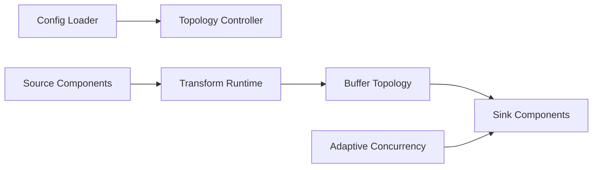

# vectordotdev/vector

> Pipeline de données d'observabilité en Rust, pour collecter, transformer et router logs et métriques.

## Le problème
Les agents de logs sont fragmentés, coûteux et verrouillés sur un fournisseur ; changer de backend casse les flux.

## Ce que ça fait vraiment
Déployé en agent ou agrégateur, Vector lit des sources, transforme (VRL, remap, dedupe, filtres), applique des tampons (buffers) puis envoie vers des sinks (S3, Elasticsearch, ClickHouse, GCS…). Concurrence adaptative sur les sinks, API gRPC et « tap » pour inspecter le flux. Maintenu par l'équipe open source de Datadog. Les chiffres de performance sont ceux de l'auteur.

## Comment c'est branché

## Essayer
Aucune commande d'installation dans le README : il renvoie au guide quickstart de vector.dev (non documenté ici).

## Coût et pièges
Gratuit. Métriques en bêta, traces « à venir » selon le README. Plus de 2 500 issues ouvertes.

## Ce que ce n'est pas
Pas un outil d'analyse ni de stockage : il achemine, il ne visualise rien. Le tableau comparatif vient de l'auteur.

## Alternatives
Filebeat, Fluent Bit, Fluentd, Logstash, Splunk UF/HF, Telegraf (comparés dans le README).

## Pour toi
Surveiller : utile si tu opères des plateformes MLOps avec beaucoup de logs et de métriques, sinon superflu.

