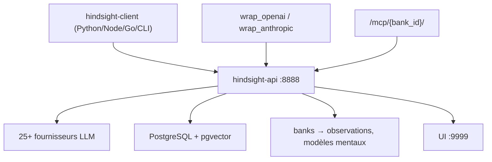

# vectorize-io/hindsight

> Memory system for agents, focused on long-term learning rather than conversation recall.

## The problem
An agent that only retains the dialogue history repeats its mistakes: it remembers what was said, but not what it understood.

## What it actually does
Three operations: `retain` (extraction of facts, entities, relations, and temporal data),
`recall` (four strategies running in parallel – semantic, BM25, graph-based, and temporal – combined using reciprocal rank fusion and then re-ranked by a cross-encoder), and `reflect` (in-depth analysis).

Four types of memory: world knowledge, experiences, consolidated observations with citations and evidence count, and mental models (permanent responses rewritten in the background). The memories reside in watertight *banks*. An MCP endpoint is exposed by each bank.

## How it is wired


## Trying it
```bash
docker run -it --pull always --name hindsight --restart unless-stopped -p 8888:8888 -p 9999:9999 \
  -e HINDSIGHT_API_LLM_API_KEY=$OPENAI_API_KEY \
  -v hindsight-data:/home/hindsight/.pg0 \
  ghcr.io/vectorize-io/hindsight:latest
pip install hindsight-client -U
pip install hindsight-all -U
```

## Cost and gotchas
Each `retain` call triggers an LLM extraction call: the invoice follows the ingested volume, not the
volume queried. Self-hosted, it requires PostgreSQL + pgvector (or Oracle 23ai). Hindsight Cloud is
billed on a usage basis. On a Mac Intel, you need `hindsight-all-slim` instead of `hindsight-all`.

## What it is not
Not just a simple vector store: the README indicates that it is oversized for a simple n8n workflow.
Benchmark scores from competitors are self-reported by their publishers, and only those from Hindsight are presented as being reproduced by third parties. Memory Defense (scanning for secrets/PII) is optional and disabled by default.

## Alternatives
- RAG (Retrieval-Augmented Generation) and knowledge graphs: the two techniques that the README claims to surpass.
- Hindsight Cloud: the managed version, if you don't want to manage the server yourself.

## For you
The most thoroughly documented candidate in the "agent memory" category – who should be tested on a disposable bank before any commitment.
