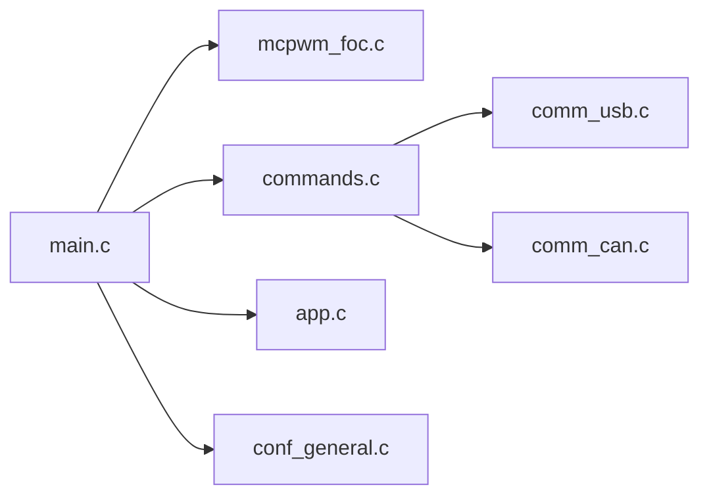

# vedderb/bldc

> Open source firmware for VESC motor controllers (DC/BLDC/FOC), for electronics engineers and electric vehicle makers.

## The problem
Finely driving a brushless motor requires real-time embedded firmware.

## What it actually does
At startup, `main.c` initializes motor control (FOC, sensors, IMU), commands, USB and CAN, then the entry application. Compatible with many boards, extensible through an embedded Lisp interpreter.

## How it is wired


## Trying it
```bash
git clone http://github.com/vedderb/bldc.git
cd bldc
make arm_sdk_install
make 100_250
```

## Cost and gotchas
VESC hardware required; flashing through STLink or VESC Tool. Risk of bricking the board if power is cut during upload.

## What it is not
Not PC software. License: none declared in the catalog, so reuse rights are uncertain.

## Alternatives
- None cited in the README.

## For you
Ignore: embedded electronics unrelated to data/AI, and an undeclared license.
