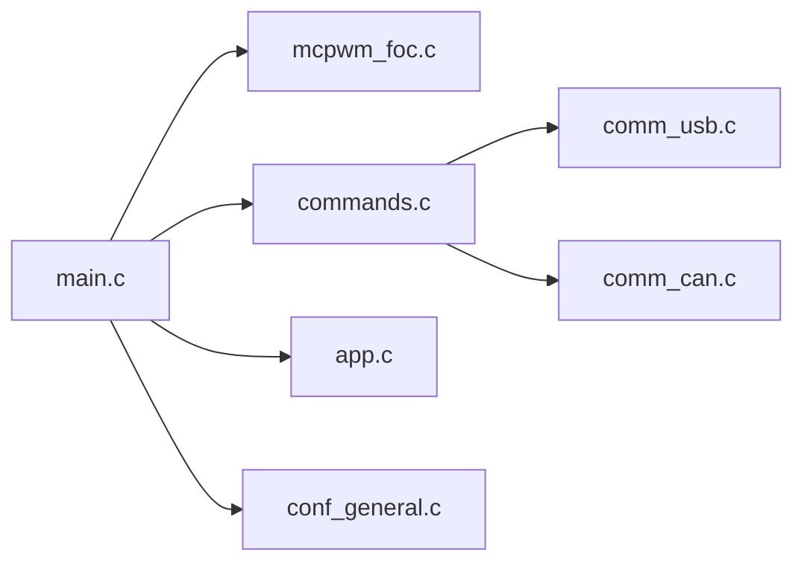

# vedderb/bldc

> Firmware open source de contrôleur moteur VESC (DC/BLDC/FOC), pour électroniciens et fabricants de véhicules électriques.

## Le problème
Piloter finement un moteur sans balais demande un firmware embarqué temps réel.

## Ce que ça fait vraiment
Au démarrage, `main.c` initialise le contrôle moteur (FOC, capteurs, IMU), les commandes, USB et CAN, puis l'application d'entrée. Compatible avec de nombreuses cartes, extensible par un interpréteur Lisp embarqué.

## Comment c'est branché


## Essayer
```bash
git clone http://github.com/vedderb/bldc.git
cd bldc
make arm_sdk_install
make 100_250
```

## Coût et pièges
Matériel VESC requis ; flashage par STLink ou VESC Tool. Risque de briquer la carte si l'alimentation est coupée pendant l'envoi.

## Ce que ce n'est pas
Pas un logiciel pour PC. Licence : aucune déclarée au catalogue, donc droits de réutilisation incertains.

## Alternatives
- Aucune citée dans le README.

## Pour toi
À ignorer : électronique embarquée sans lien avec data/IA, et licence non déclarée.

