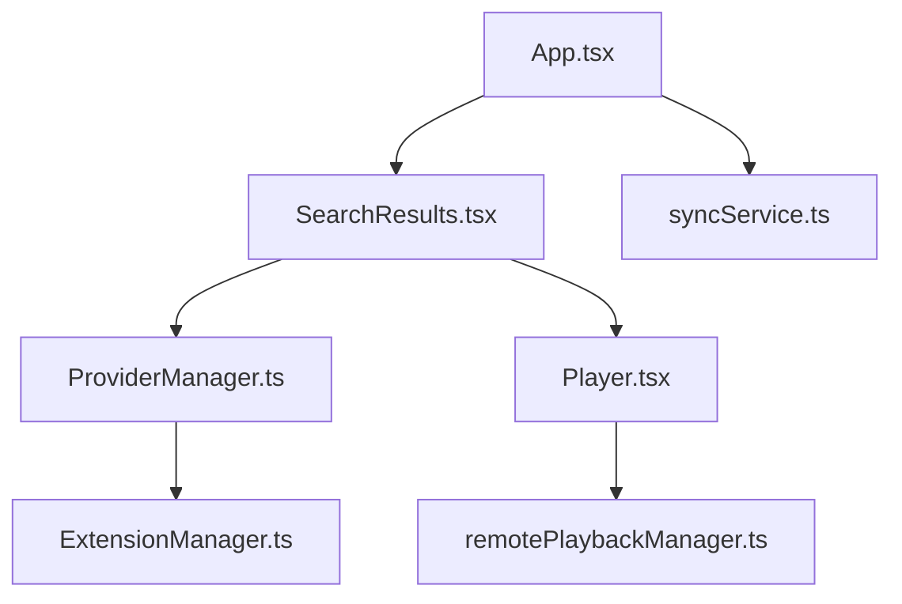

# vega-org/vega-app

> Android media streaming and casting application, extensible through provider plugins.

## The problem
Watching content from various sources forces you to switch apps and to handle downloads and TV casting yourself.

## What it actually does
It searches for titles from providers added through plugins, plays the streams, downloads them, casts them to Google Cast or DLNA with an in-house remuxer (audio tracks and subtitles), manages a watchlist, opens external players and syncs with a desktop application.

## How it is wired


## Trying it
```bash
git clone https://github.com/vega-org/vega-app.git
cd vega-app
npm install
npx expo prebuild -p android --clean
npm run android
```

## Cost and gotchas
Free. A React Native environment is required. The application hosts no content: the README disclaimer says everything comes from third-party providers that the user adds, with the legal risks that follow. License not identified by GitHub.

## What it is not
Not a content service: it provides none.

## Alternatives
No alternative named in the README.

## For you
Ignore: an Android media player whose use depends on third-party sources, with an unclear license and unrelated to your field.
