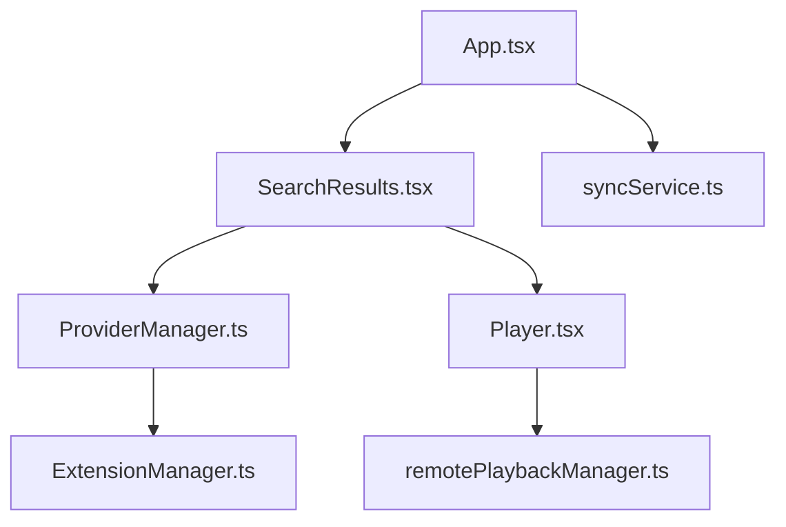

# vega-org/vega-app

> Application Android de streaming et de diffusion de médias, extensible par plugins de fournisseurs.

## Le problème
Regarder du contenu issu de sources diverses oblige à changer d'application et à gérer soi-même téléchargements et diffusion sur téléviseur.

## Ce que ça fait vraiment
Elle recherche des titres auprès de fournisseurs ajoutés par plugins, lit les flux, les télécharge, les diffuse vers Google Cast ou DLNA avec un remuxeur maison (pistes audio et sous-titres), gère une liste de suivi, ouvre des lecteurs externes et synchronise avec une application de bureau.

## Comment c'est branché


## Essayer
```bash
git clone https://github.com/vega-org/vega-app.git
cd vega-app
npm install
npx expo prebuild -p android --clean
npm run android
```

## Coût et pièges
Gratuit. Il faut un environnement React Native. L'application n'héberge aucun contenu : l'avertissement du README dit que tout vient de fournisseurs tiers que l'utilisateur ajoute, avec les risques légaux qui en découlent. Licence non identifiée par GitHub.

## Ce que ce n'est pas
Ce n'est pas un service de contenu : elle n'en fournit aucun.

## Alternatives
Aucune alternative nommée dans le README.

## Pour toi
À ignorer : lecteur multimédia Android dont l'usage dépend de sources tierces, avec licence floue et sans rapport avec ton métier.

