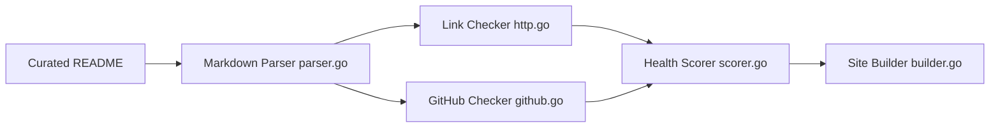

# veggiemonk/awesome-docker

> Annotated list of projects and resources for Docker, with a Go tool that checks link health.

## The problem
Finding the right tools in the Docker ecosystem among a large number of projects.

## What it actually does
A README organized by theme (engines, build, registries, scanning and SBOM, networking, observability, security, interfaces, CI/CD, learning). A Go CLI parses the README, checks links and the health of GitHub repositories, computes a score, caches results and can generate a website.

## How it is wired

## Trying it
No documented command: you read the list.

## Cost and gotchas
Free. Some entries are commercial (marked `:yen:`). Some items are old (e.g. an article from 2016).

## What it is not
Not a selection guide: no recommendations, no comparisons. The listed projects are not individually evaluated.

## Alternatives
Awesome Compose, Awesome Kubernetes, Awesome Selfhosted: other lists cited in the README, focused on specific use cases.

## For you
Worth watching as a bookmark to spot a Docker tool (scanning, SBOM, registries) when you need one; not meant to be read in one go.
