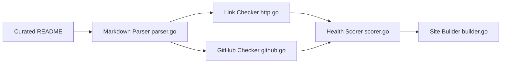

# veggiemonk/awesome-docker

> Liste commentée de projets et ressources pour Docker, avec un outil Go qui contrôle la santé des liens.

## Le problème
Retrouver les bons outils de l'écosystème Docker au milieu d'un grand nombre de projets.

## Ce que ça fait vraiment
Un README classé par thèmes (moteurs, build, registres, scan et SBOM, réseau, observabilité, sécurité, interfaces, CI/CD, apprentissage). Un CLI Go analyse le README, vérifie les liens et la santé des dépôts GitHub, calcule un score, met en cache et peut générer un site web.

## Comment c'est branché

## Essayer
Aucune commande documentée : on lit la liste.

## Coût et pièges
Gratuit. Entrées parfois commerciales (marquées `:yen:`). Certains éléments sont anciens (ex. un article de 2016).

## Ce que ce n'est pas
Pas un guide de choix : aucune recommandation, aucun comparatif. Les projets listés ne sont pas évalués individuellement.

## Alternatives
Awesome Compose, Awesome Kubernetes, Awesome Selfhosted : d'autres listes citées dans le README, centrées sur des cas précis.

## Pour toi
À surveiller comme signet pour repérer un outil Docker (scan, SBOM, registres) quand tu en as besoin ; pas à lire d'une traite.

