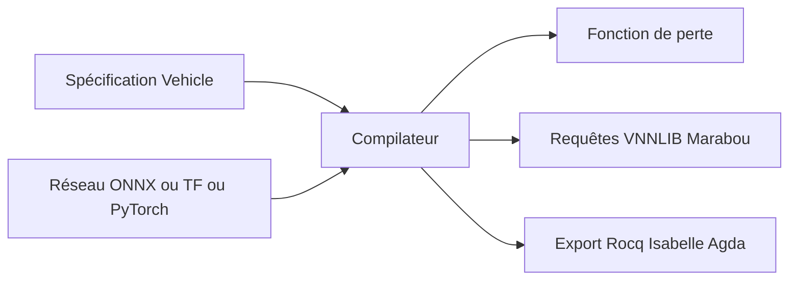

# vehicle-lang/vehicle

> Specification language for expressing, training and formally verifying properties of neural networks.

## The problem
Testing a neural network does not prove that a property holds for all inputs, and tying a proof to the deployed network is hard.

## What it actually does
You write a specification in a high-level functional language. It compiles into a loss function for training, then into queries for solvers that prove the property or give a counterexample. It can be exported to proof assistants (Rocq, Isabelle, Agda, Imandra). Formats: ONNX, TensorFlow, PyTorch, IDX.

## How it is wired
Simplified diagram based on the sheet, no diagram provided.

## Trying it
No command documented in the README: it points to the manual and the tutorial.

## Cost and gotchas
Free, but the solvers (Marabou, VNNLIB solvers) must be installed separately. Expertise in formal methods is useful. A PyPI mention suggests a pip package, not detailed.

## What it is not
Not a model testing or monitoring tool: it aims at formal proof. Does not scale to large models: not documented.

## Alternatives
No alternative named in the README.

## For you
Worth watching: interesting if you work on the reliability of critical neural networks, but niche, with a license to verify.
