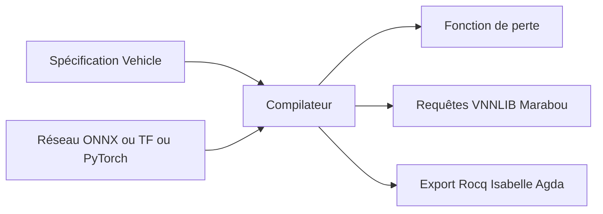

# vehicle-lang/vehicle

> Langage de spécification pour exprimer, entraîner et vérifier formellement des propriétés de réseaux de neurones.

## Le problème
Tester un réseau de neurones ne prouve pas qu'une propriété tient pour toutes les entrées, et lier une preuve au réseau déployé est difficile.

## Ce que ça fait vraiment
On écrit une spécification dans un langage fonctionnel de haut niveau. Elle se compile en fonction de perte pour l'entraînement, puis en requêtes pour des solveurs qui prouvent la propriété ou donnent un contre-exemple. Elle peut s'exporter vers des assistants de preuve (Rocq, Isabelle, Agda, Imandra). Formats : ONNX, TensorFlow, PyTorch, IDX.

## Comment c'est branché
Schéma simplifié d'après la fiche, sans diagramme fourni.

## Essayer
Aucune commande documentée dans le README : il renvoie au manuel et au tutoriel.

## Coût et pièges
Gratuit, mais les solveurs (Marabou, solveurs VNNLIB) sont à installer à part. Une expertise en méthodes formelles est utile. Une mention PyPI suggère un paquet pip, non détaillé.

## Ce que ce n'est pas
Pas un outil de test ou de monitoring de modèles : il vise la preuve formelle. Ne passe pas à l'échelle de gros modèles : non documenté.

## Alternatives
Aucune alternative nommée dans le README.

## Pour toi
À surveiller : intéressant si tu travailles sur la fiabilité de réseaux de neurones critiques, mais de niche, avec une licence à vérifier.

