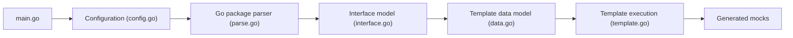

# vektra/mockery

> Mock generator for Go interfaces, based on testify/mock, for Go developers.

## The problem
Writing mocks of Go interfaces by hand for unit tests is repetitive.

## What it actually does
Loads the configuration, discovers the configured packages and interfaces, builds typed data, applies templates (local or remote) and writes the mock files. The `init`, `migrate` and `showconfig` commands manage the configuration. The README is very brief and points to a GitHub Pages site for documentation; installation is not described there.

## How it is wired


## Trying it
```bash
go mod download -x
task test
```
(Development commands from the README, not usage.)

## Cost and gotchas
Free. Actual usage is in the external documentation, not covered here.

## What it is not
Not a testing framework: it only produces mock code for testify.

## Alternatives
No alternative named in the README.

## For you
Ignore: only useful if you write Go with testify; your data/AI stack is mostly Python.
