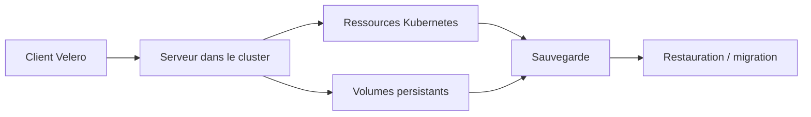

# velero-io/velero

> Backup, restore and migration of the resources and volumes of a Kubernetes cluster.

## The problem
A lost Kubernetes cluster takes its objects and persistent volumes with it; recreating the state of a
production environment, or replicating it to a test cluster, has no native solution.

## What it actually does
Backs up the cluster's resources and persistent volumes, then restores them in case of loss.
Also used to migrate resources to another cluster, or to replicate production into development and test
environments. Two components: a server that runs in the cluster
and a local command-line client. Formerly Heptio Ark, a CNCF **sandbox** project.

## How it is wired

## Trying it
No command is given in this README; it points to https://velero.io/docs/ for the getting-started guide
and for building from source.

## Cost and gotchas
Free, but the backup destination (cloud or on-premises object storage) is billed separately.
Compatibility: Velero 1.14 to 1.18 target Kubernetes 1.18 and above, tested on a subset of versions
only — the project recommends testing your combination before installing or upgrading.

## What it is not
Not a guarantee of restoration on every version combination: the compatibility table only covers
what is actually tested. The upgrade path is only verified for n-2 minor versions.
CNCF sandbox status, not graduated.

## Alternatives
No alternative repository is named in the README.

## For you
Essential as soon as models or databases live in PVCs you do not want to lose.
