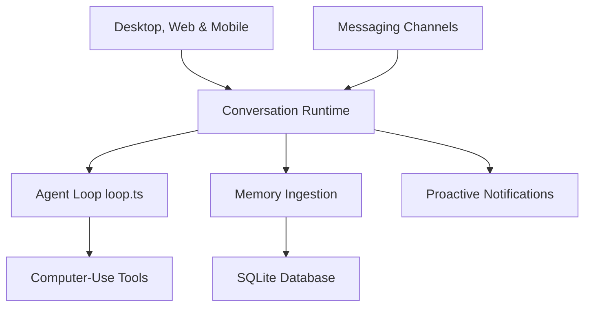

# vellum-ai/vellum-assistant

> Personal AI assistant with eight types of memory, running locally or on the Vellum platform.

## The problem
Building a personal assistant on OpenClaw, Hermes Agent or Claude Code takes setup time, and it quickly forgets.

## What it actually does
Desktop application (macOS, Windows) with a `vellum` CLI. The assistant keeps a memory of eight types with dense and sparse retrieval, writes its personality files (SOUL.md, NOW.md), rereads its notes every hour to alert you, and acts through permission-gated tools in a sandbox. It reaches you via Telegram, Slack, e-mail and voice, and handles several model providers, including Ollama locally. Plugins are defined with SKILL.md and TOOLS.json.

## How it is wired
Based on the provided diagram, simplified.



## Trying it
```bash
bun install -g vellum
vellum hatch
vellum wake
vellum client
```

## Cost and gotchas
Managed mode requires a Vellum Cloud account. Models go through API keys at your expense, except Ollama locally. The Windows build is a development version tied to the development environment.

## What it is not
Not a simple Markdown memory file. The CLI comes second to the desktop application. Several modules in the diagram are not detailed, their links are unverified.

## Alternatives
OpenClaw, Hermes Agent and Claude Code, cited in the README as points of comparison.

## For you
Worth watching: a young project (created in February 2026) and ambitious on agent memory, to revisit later before trusting it with data.
