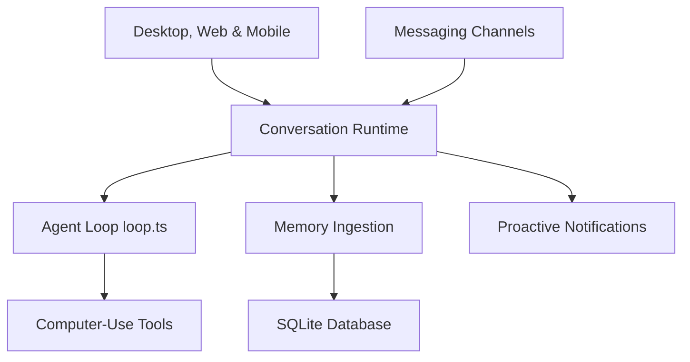

# vellum-ai/vellum-assistant

> Assistant IA personnel à huit types de mémoire, qui tourne en local ou sur la plateforme Vellum.

## Le problème
Monter un assistant personnel sur OpenClaw, Hermes Agent ou Claude Code demande du temps de configuration, et il oublie vite.

## Ce que ça fait vraiment
Application bureau (macOS, Windows) avec CLI `vellum`. L'assistant garde une mémoire en huit types avec récupération dense et éparse, écrit ses fichiers de personnalité (SOUL.md, NOW.md), relit ses notes chaque heure pour te prévenir, et agit via des outils soumis à permission dans un bac à sable. Il passe par Telegram, Slack, e-mail et voix, et gère plusieurs fournisseurs de modèles, dont Ollama en local. Des plugins se définissent par SKILL.md et TOOLS.json.

## Comment c'est branché
D'après le diagramme fourni, simplifié.



## Essayer
```bash
bun install -g vellum
vellum hatch
vellum wake
vellum client
```

## Coût et pièges
Le mode géré demande un compte Vellum Cloud. Les modèles passent par des clés d'API à ta charge, sauf Ollama en local. Le build Windows est une version de développement reliée à l'environnement de développement.

## Ce que ce n'est pas
Pas un simple fichier Markdown de mémoire. La CLI passe après l'application bureau. Plusieurs modules du diagramme ne sont pas détaillés, leurs liens sont non vérifiés.

## Alternatives
OpenClaw, Hermes Agent et Claude Code, cités dans le README comme points de comparaison.

## Pour toi
À surveiller : projet jeune (créé en février 2026) et ambitieux sur la mémoire d'agent, à relire plus tard avant d'y confier des données.

