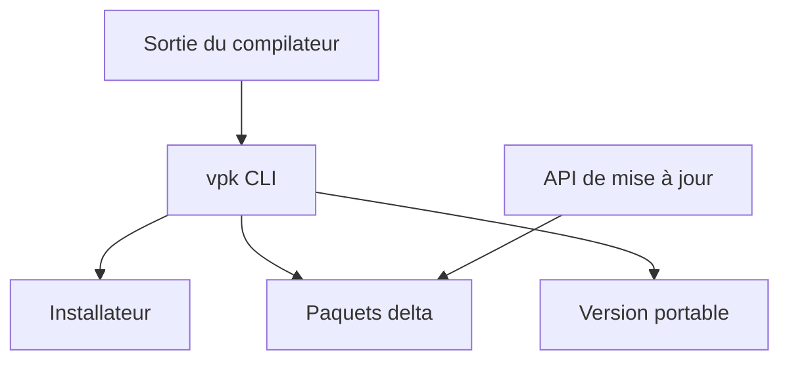

# velopack/velopack

> Framework for installing and automatically updating cross-platform desktop applications.

## The problem
Shipping an installer and updates without writing scripts specific to each system.

## What it actually does
One command, vpk, takes the compiler output and produces an installer, delta packages and a self-updating portable version for Windows, macOS and Linux. Written in Rust, it offers an API for C#, C++, JS and Rust. It can migrate Squirrel applications. The README mostly cites testimonials.

## How it is wired
Simplified diagram based on the sheet, no diagram provided.

## Trying it
No command documented in this README: see the documentation and getting-started guides.

## Cost and gotchas
Free. The README does not say where to host the update files; code signing is handled on the user's side.

## What it is not
Not a packaging tool for servers or containers: it targets desktop applications.

## Alternatives
Squirrel, from which Velopack allows migration.

## For you
Ignore: useful only if you distribute a desktop application; outside the data/AI scope.
