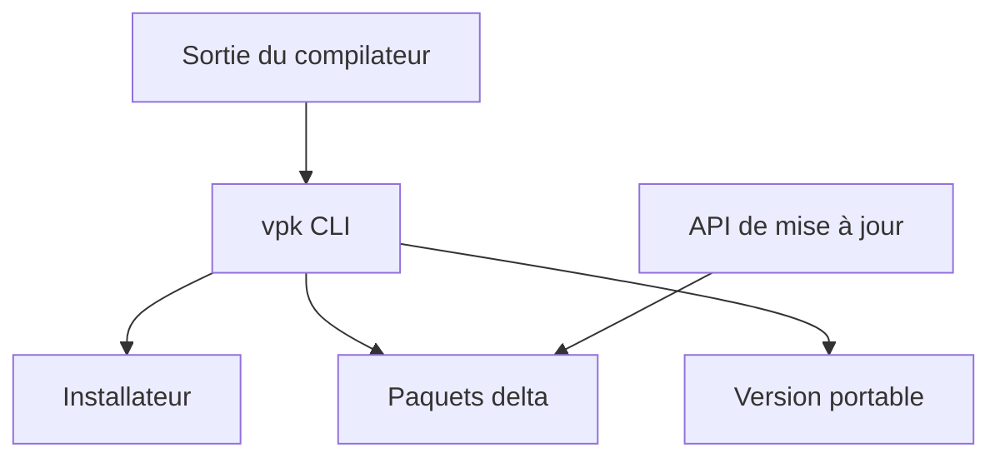

# velopack/velopack

> Cadriciel d'installation et de mise à jour automatique d'applications de bureau multiplateformes.

## Le problème
Livrer un installateur et des mises à jour sans écrire de scripts spécifiques à chaque système.

## Ce que ça fait vraiment
Une commande, vpk, prend la sortie du compilateur et produit installateur, paquets delta et version portable auto-mise à jour pour Windows, macOS et Linux. Écrit en Rust, il propose une API pour C#, C++, JS et Rust. Il peut migrer des applications Squirrel. Le README cite surtout des témoignages.

## Comment c'est branché
Schéma simplifié d'après la fiche, sans diagramme fourni.

## Essayer
Aucune commande documentée dans ce README : voir la documentation et les guides de démarrage.

## Coût et pièges
Gratuit. Le README ne dit pas où héberger les fichiers de mise à jour ; la signature de code se règle côté utilisateur.

## Ce que ce n'est pas
Pas un outil de packaging pour serveurs ni pour conteneurs : il vise les applications de bureau.

## Alternatives
Squirrel, dont Velopack permet la migration.

## Pour toi
À ignorer : utile seulement si tu distribues une application de bureau ; hors périmètre data/IA.

