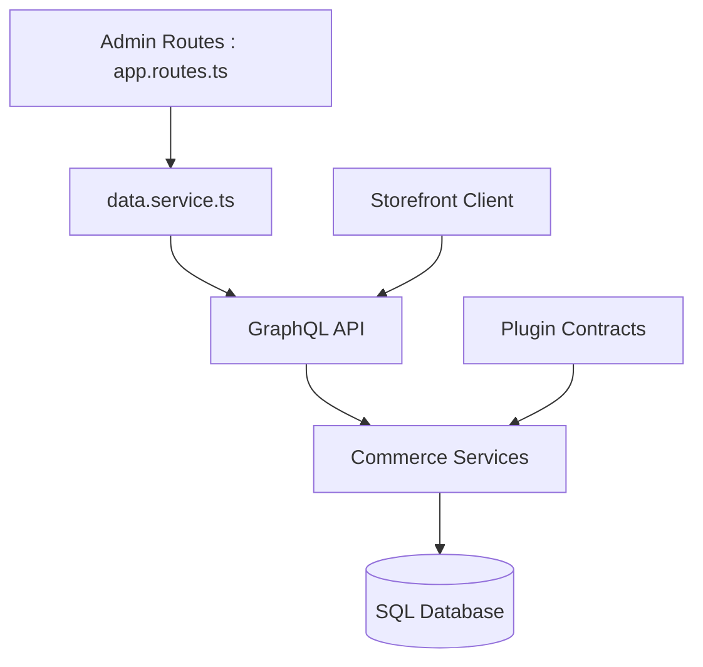

# vendurehq/vendure

> Extensible e-commerce backend in TypeScript and GraphQL, for B2B and multichannel teams.

## The problem
E-commerce platforms impose a rigid model: adapting catalog, pricing, promotions and orders often means forking the core.

## What it actually does
Headless backend on Node.js, NestJS and GraphQL, with catalog, orders, stock, promotions, payments, channels and a React admin dashboard. Everything is extended through plugins without touching the core. From the code: commerce services behind the GraphQL API, state in a SQL database, an event bus, job queues in SQL or Redis and S3 asset storage.

## How it is wired


## Trying it
```bash
npx @vendure/create my-shop
```

## Cost and gotchas
The core is free to self-host. It requires Node 22.12 or later and a SQL database (PostgreSQL, MySQL, MariaDB or SQLite). Four paid plans add B2B features, support and a commercial license; Vendure Cloud is in preview. License not identified by GitHub.

## What it is not
It is not a turnkey shop: it is a development foundation. Advanced B2B features (quotes, SSO, audit logs) are in the paid plans.

## Alternatives
No alternative named in the README.

## For you
Ignore: e-commerce, unrelated to data or MLOps; only the introspectable GraphQL schema, mentioned for MCP tools, might be of interest.
