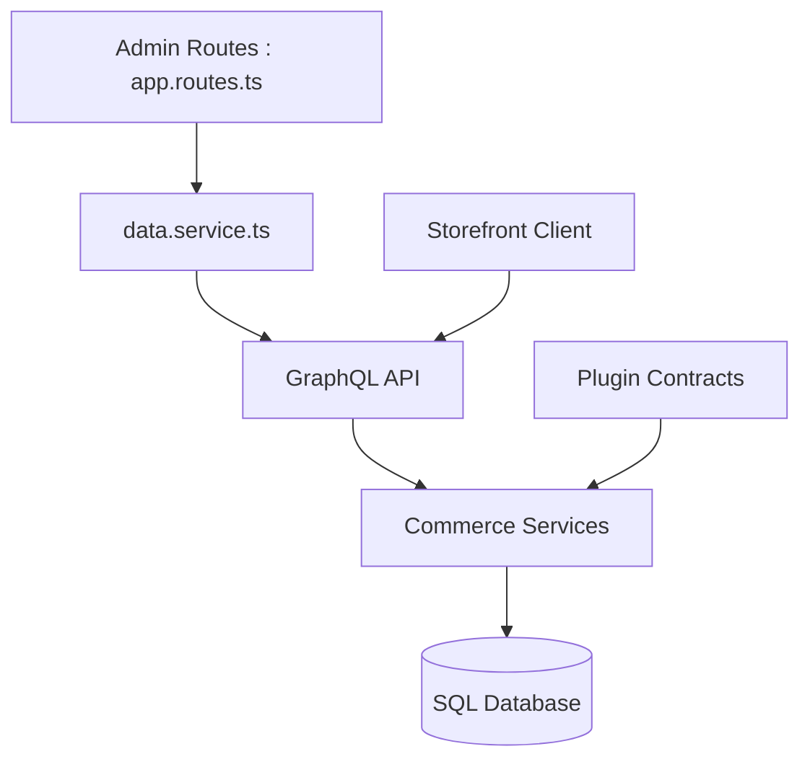

# vendurehq/vendure

> Backend de commerce électronique extensible en TypeScript et GraphQL, pour équipes B2B et multicanal.

## Le problème
Les plateformes e-commerce imposent un modèle rigide : adapter catalogue, prix, promotions et commandes oblige souvent à forker le cœur.

## Ce que ça fait vraiment
Backend headless Node.js, NestJS et GraphQL, avec catalogue, commandes, stock, promotions, paiements, canaux et tableau de bord d'administration en React. Tout se prolonge par des plugins sans toucher au cœur. D'après le code : services de commerce derrière l'API GraphQL, état en base SQL, bus d'événements, files de tâches en SQL ou Redis et stockage d'assets S3.

## Comment c'est branché


## Essayer
```bash
npx @vendure/create my-shop
```

## Coût et pièges
Le cœur s'auto-héberge gratuitement. Il faut Node 22.12 ou plus et une base SQL (PostgreSQL, MySQL, MariaDB ou SQLite). Quatre offres payantes ajoutent fonctions B2B, support et licence commerciale ; Vendure Cloud est en préversion. Licence non identifiée par GitHub.

## Ce que ce n'est pas
Ce n'est pas une boutique clé en main : c'est un socle de développement. Les fonctions B2B avancées (devis, SSO, journaux d'audit) sont dans les offres payantes.

## Alternatives
Aucune alternative nommée dans le README.

## Pour toi
À ignorer : e-commerce, sans rapport avec la data ou le MLOps ; seul le schéma GraphQL introspectable, cité pour les outils MCP, pourrait intéresser.

