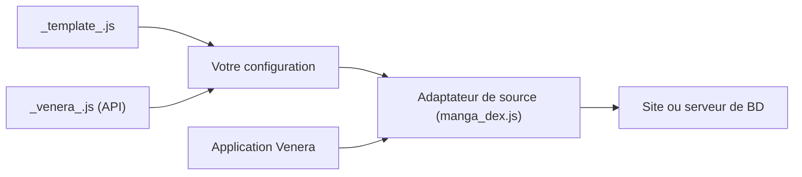

# venera-app/venera-configs

> Repository of JavaScript comic source configurations for the Venera application.

## The problem
Venera needs adapters to read comics from each site or server.

## What it actually does
Contains independent JS files (MangaDex, Komga, Kavita, Lanraragi, E-Hentai, Hitomi, Copy Manga…), each implementing browsing, search, detail and chapters, sometimes accounts, favorites and comments. A `_template_.js` template and a `_venera_.js` API file for autocompletion are used to write new ones. The README is very short (under 800 characters): the detail comes from the architecture as read from the code.

## How it is wired


## Trying it
```bash
# README : télécharger _template_.js et _venera_.js dans le même dossier,
# renommer _template_.js en your_config_name.js, puis l'éditer.
```

## Cost and gotchas
Free, but no license is declared. Some sources are adult content or of uncertain rights: check according to your country.

## What it is not
Not the Venera application itself. The sources are independent of one another.

## Alternatives
No alternative named in the README.

## For you
Ignore: configurations for a comic reader, unrelated to your field.
