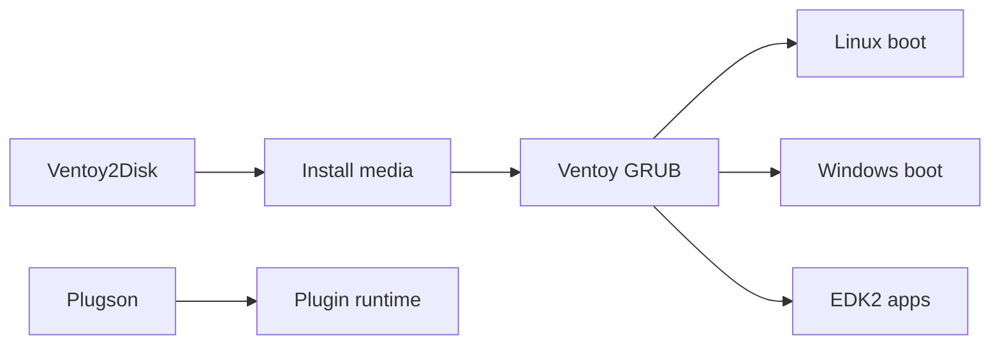

# ventoy/Ventoy

> Creates a bootable USB drive where you simply copy ISO, WIM, IMG, VHD or EFI images.

## The problem
Reformatting the drive for every new system image is long and tedious.

## What it actually does
You install Ventoy once on the disk; the image files copied to the data partition appear in a boot menu. Supports Legacy BIOS, UEFI (x86, IA32, ARM64, MIPS64EL), MBR and GPT, Secure Boot, Linux persistence, automatic installation and plugins configurable through an interface (VentoyPlugson). More than 1300 ISOs tested.

## How it is wired

## Trying it
The README gives no command: it points to https://www.ventoy.net/en/doc_start.html. Building: see `BuildVentoyFromSource.txt`.

## Cost and gotchas
Free, donations accepted. The README asks you to report problems directly to the project, not to the OS vendor.

## What it is not
Not a virtualization or fleet management tool: it is used to boot physical machines. The repository ships precompiled binaries and third-party utilities.

## Alternatives
No alternative named in the README.

## For you
Watch: handy for troubleshooting or installing machines (GPUs, servers), but outside your core data / AI work and carried by a single maintainer.
