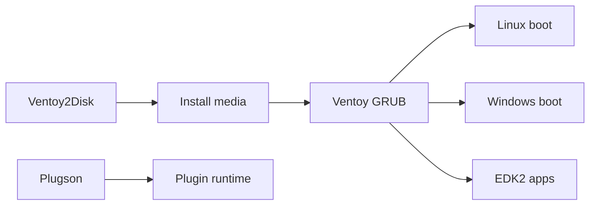

# ventoy/Ventoy

> Crée une clé USB bootable où l'on copie simplement des images ISO, WIM, IMG, VHD ou EFI.

## Le problème
Reformater la clé à chaque nouvelle image système est long et fastidieux.

## Ce que ça fait vraiment
On installe Ventoy une fois sur le disque ; les fichiers image copiés dans la partition de données apparaissent dans un menu de démarrage. Gère BIOS Legacy, UEFI (x86, IA32, ARM64, MIPS64EL), MBR et GPT, Secure Boot, persistance Linux, installation automatique et plugins configurables via une interface (VentoyPlugson). Plus de 1300 ISO testées.

## Comment c'est branché

## Essayer
Le README ne donne pas de commande : il renvoie à https://www.ventoy.net/en/doc_start.html. Compilation : voir `BuildVentoyFromSource.txt`.

## Coût et pièges
Gratuit, dons acceptés. Le README invite à signaler les problèmes directement au projet, non à l'éditeur de l'OS.

## Ce que ce n'est pas
Pas un outil de virtualisation ni de gestion de parc : il sert à démarrer des machines physiques. Le dépôt embarque des binaires pré-compilés et des utilitaires tiers.

## Alternatives
Aucune alternative nommée dans le README.

## Pour toi
À surveiller : pratique pour dépanner ou installer des machines (GPU, serveurs), mais hors cœur de métier data / IA et porté par un seul mainteneur.

