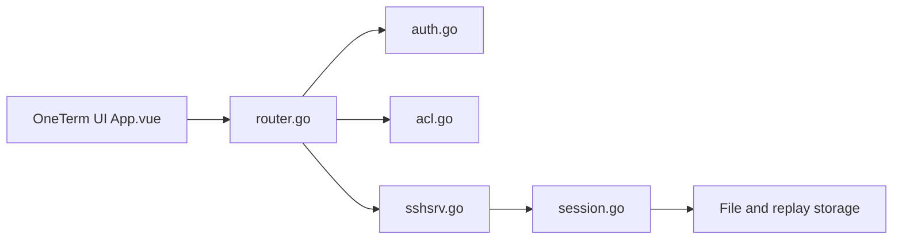

# veops/oneterm

> SSH/RDP access bastion in Go with authentication, permissions, session recording and audit.

## The problem
Controlling and tracing privileged access to internal servers from a single entry point.

## What it actually does
Users authenticate in OneTerm then connect to authorized machines through a jump server and protocol connectors. It records sessions for replay, manages passwords, enforces MFA and authorization rules, offers a privileged access request flow, and integrates with the Veops CMDB. Go backend, Vue frontend.

## How it is wired


## Trying it
```bash
git clone https://github.com/veops/oneterm.git
cd oneterm/deploy
./setup.sh
docker compose up -d
# interface sur http://127.0.0.1:8666
```

## Cost and gotchas
Free. The quick deployment keeps the default password 123456: use `setup.sh` in production. The `main` branch can be unstable; prefer the releases. Last push in February 2026.

## What it is not
Not a data/AI tool: infrastructure security. AGPL-3.0.

## Alternatives
No alternative named in the README.

## For you
Ignore for a data/AI profile: a bastion is the infra team's concern, not part of your daily work.
