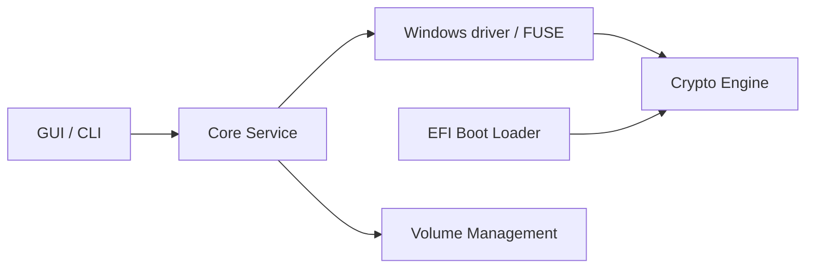

# veracrypt/VeraCrypt

> Cross-platform disk and volume encryption, derived from TrueCrypt 7.1a.

## The problem
Data on disk is readable by anyone who gets hold of the machine or the media.

## What it actually does
VeraCrypt source repository: graphical (wxWidgets) and text interfaces, core service, Windows kernel driver and FUSE module (Linux/macOS), EFI boot loader, crypto engine (AES, Serpent, Twofish…) and volume management. The README is mostly a build guide for Windows, Linux, macOS, FreeBSD/OpenBSD.

## How it is wired


## Trying it
```bash
make WXSTATIC=1 WX_ROOT=/usr/src/wxWidgets wxbuild
make WXSTATIC=1
```

## Cost and gotchas
Free. Heavy build dependencies (wxWidgets, YASM, FUSE); signed Windows drivers only in the official binaries.

## What it is not
Custom license (`License.txt`), not identified by GitHub: a derivative cannot carry the name VeraCrypt or TrueCrypt. Not a backup.

## Alternatives
No alternative named, apart from TrueCrypt from which it derives.

## For you
Worth watching for encrypting disks and sensitive datasets; read the license before any redistribution.
