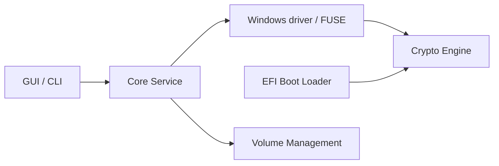

# veracrypt/VeraCrypt

> Chiffrement de disque et de volumes multiplateforme, dérivé de TrueCrypt 7.1a.

## Le problème
Les données sur disque sont lisibles par quiconque met la main sur la machine ou le support.

## Ce que ça fait vraiment
Dépôt de sources de VeraCrypt : interfaces graphique (wxWidgets) et texte, service cœur, pilote noyau Windows et module FUSE (Linux/macOS), chargeur EFI, moteur crypto (AES, Serpent, Twofish…) et gestion des volumes. Le README est surtout un guide de compilation Windows, Linux, macOS, FreeBSD/OpenBSD.

## Comment c'est branché


## Essayer
```bash
make WXSTATIC=1 WX_ROOT=/usr/src/wxWidgets wxbuild
make WXSTATIC=1
```

## Coût et pièges
Gratuit. Dépendances de build lourdes (wxWidgets, YASM, FUSE) ; pilotes Windows signés seulement dans les binaires officiels.

## Ce que ce n'est pas
Licence personnalisée (`License.txt`), non identifiée par GitHub : un dérivé ne peut pas porter le nom VeraCrypt ou TrueCrypt. Pas une sauvegarde.

## Alternatives
Aucune alternative nommée, hors TrueCrypt dont il dérive.

## Pour toi
À surveiller pour chiffrer disques et jeux de données sensibles ; lis la licence avant toute redistribution.

