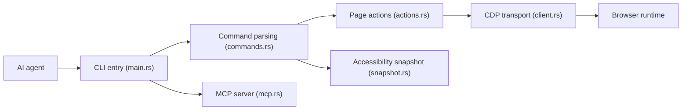

# vercel-labs/agent-browser

> CLI (Command-Line Interface) for controlling a web browser for AI agents, with accessibility snapshots and MCP server.

## The problem
An agent that automates web interactions needs a controllable browser, stable references to web elements, and a token-efficient output.

## What it actually does
A Rust-based demon directly communicates with Chrome (as well as Lightpanda, Obscura, Safari/iOS). The process involves: `snapshot` returning the accessibility tree with references `@e1`, followed by `click`/`fill` actions on it. Furthermore, it supports: isolated sessions, profiles, a secure authentication vault, a list of authorized domains, action policies, axe-core auditing, React tools, MCP, a dashboard, and cloud providers (Browserbase, Kernel…).

## How it is wired


## Trying it
```bash
npm install -g agent-browser
agent-browser install
agent-browser open example.com
agent-browser snapshot
agent-browser click @e2
agent-browser screenshot page.png
```

## Cost and gotchas
Free; Chrome is downloaded upon the first use. Cloud providers and the AI chat (Vercel AI Gateway) require keys and accounts. All security options are opt-in: without a whitelist or confirmation, the agent navigates freely. The provided README is incomplete and inconsistent, particularly regarding the iOS section (commands without a prefix).

## What it is not
Not a testing framework like Playwright; it is not inherently protected against prompt injection (as stated in the README for WebMCP). The page content is not reliable.

## Alternatives
- Playwright / Puppeteer: Installations detected and reusable, with a greater focus on testing.
- Browserbase, Browserless, Kernel: cloud-based browsers offered as services.

## For you
To be adopted to provide a browser to an agent in a token-efficient way; enable the `--allowed-domains` option as soon as the agent encounters pages it doesn't control.
