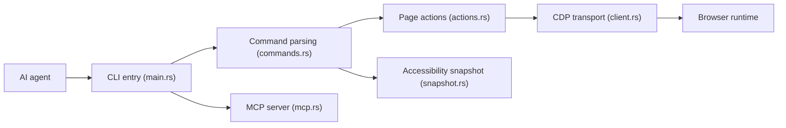

# vercel-labs/agent-browser

> CLI Rust de pilotage de navigateur pour agents IA, avec snapshots d'accessibilité et serveur MCP.

## Le problème
Un agent qui automatise le web a besoin d'un navigateur contrôlable, de références stables vers les éléments et d'une sortie économe en tokens.

## Ce que ça fait vraiment
Un démon Rust parle directement CDP à Chrome (aussi Lightpanda, Obscura, Safari/iOS). Le cycle : `snapshot` renvoie l'arbre d'accessibilité avec références `@e1`, puis `click`/`fill` agissent dessus. Au-delà : sessions isolées, profils, vault d'authentification chiffré, liste de domaines autorisés, politiques d'actions, audit axe-core, outils React, MCP, tableau de bord, fournisseurs cloud (Browserbase, Kernel…).

## Comment c'est branché


## Essayer
```bash
npm install -g agent-browser
agent-browser install
agent-browser open example.com
agent-browser snapshot
agent-browser click @e2
agent-browser screenshot page.png
```

## Coût et pièges
Gratuit ; Chrome téléchargé au premier usage. Les fournisseurs cloud, le chat IA (Vercel AI Gateway) demandent clés et comptes. Les options de sécurité sont toutes opt-in : sans allowlist ni confirmation, l'agent navigue librement. Le README fourni est coupé et incohérent vers la section iOS réel (commandes sans début).

## Ce que ce n'est pas
Pas un framework de test comme Playwright ; pas protégé contre l'injection de prompt par défaut (le README le dit pour WebMCP). Le contenu de page est non fiable.

## Alternatives
- Playwright / Puppeteer : installations détectées et réutilisables, plus orientés tests.
- Browserbase, Browserless, Kernel : navigateurs cloud intégrés comme providers.

## Pour toi
À adopter pour donner un navigateur à un agent de façon économe en tokens ; active `--allowed-domains` dès que l'agent touche des pages non maîtrisées.

