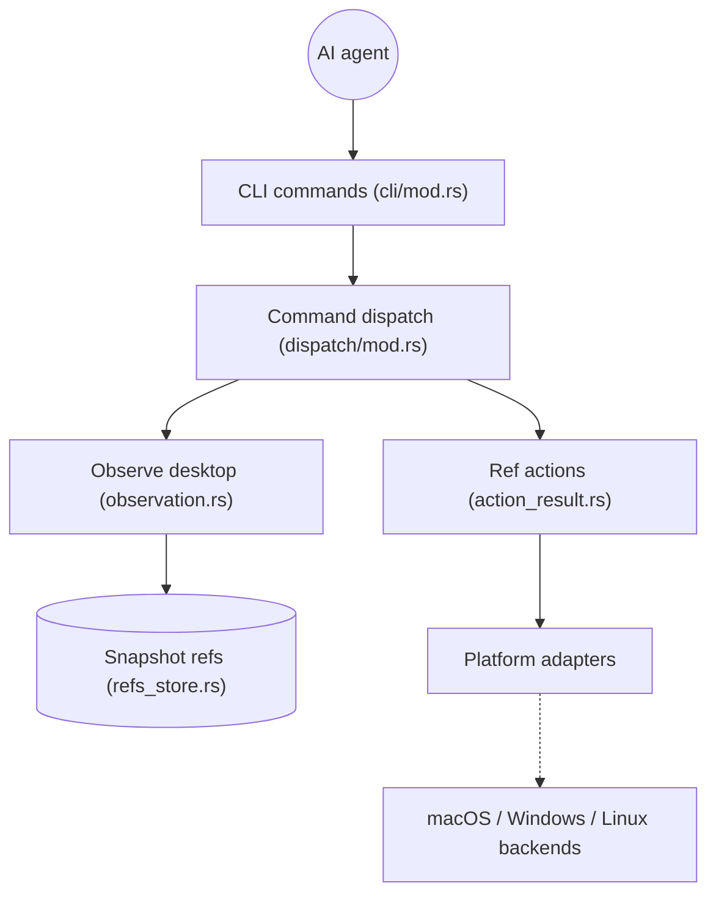

# vercel-labs/agent-desktop

> CLI and C library that let an AI agent drive desktop applications through the accessibility tree.

## The problem
"Computer use" through screenshots and pixel recognition is fragile and costly.

## What it actually does
- `snapshot` returns JSON with a reference (ref) for each actionable element; the agent acts on the ref, then takes a new snapshot.
- Refs belong to their snapshot: `STALE_REF` or `AMBIGUOUS_TARGET` if the interface changes.
- 60 command names (56 operational); macOS, Windows, Linux.
- Headless mode by default; `--headed` allows physical input. FFI binding (`libagent_desktop_ffi`).

## How it is wired


## Trying it
```bash
npm install -g agent-desktop
agent-desktop version
agent-desktop snapshot --app Finder -i
agent-desktop click @s8f3k2p9:e8
agent-desktop skills get desktop
```

## Cost and gotchas
macOS requires the Accessibility permission; on Linux, `at-spi2-core` and a graphical session. Snapshots and clipboard contents may hold private data: keep them out of logs.

## What it is not
It is not an agent: the loop stays in yours. The optional JEV assistant sends screen descriptions to a model provider. The key-down/up and mouse-down/up commands refuse to run for now.

## Alternatives
No alternative named in the README.

## For you
Worth watching: an accessibility approach that is more reliable than pixels for your agents, but young (created in February 2026), and the risk of desktop data leaks calls for real hygiene.
