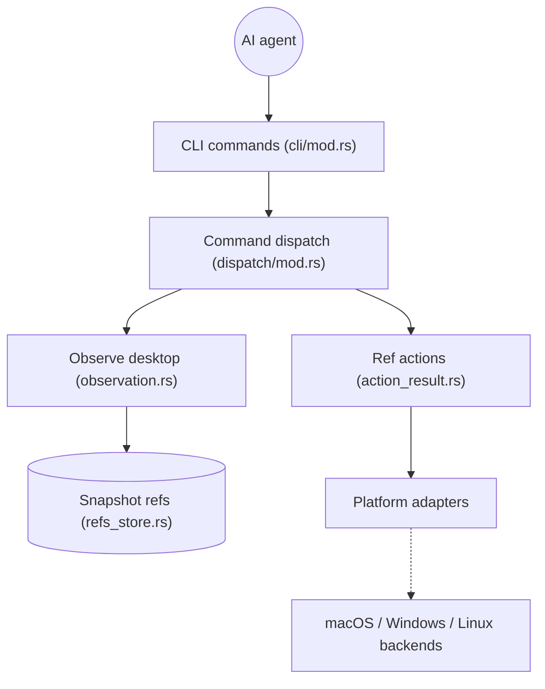

# vercel-labs/agent-desktop

> CLI et bibliothèque C qui laissent un agent IA piloter des applications de bureau via l'arbre d'accessibilité.

## Le problème
Le « computer use » par captures d'écran et reconnaissance de pixels est fragile et coûteux.

## Ce que ça fait vraiment
- `snapshot` renvoie du JSON avec une référence (ref) par élément actionnable ; l'agent agit sur la ref puis refait un snapshot.
- Les refs appartiennent à leur snapshot : `STALE_REF` ou `AMBIGUOUS_TARGET` si l'interface change.
- 60 noms de commandes (56 opérationnelles) ; macOS, Windows, Linux.
- Mode sans interface par défaut ; `--headed` autorise l'entrée physique. Liaison FFI (`libagent_desktop_ffi`).

## Comment c'est branché


## Essayer
```bash
npm install -g agent-desktop
agent-desktop version
agent-desktop snapshot --app Finder -i
agent-desktop click @s8f3k2p9:e8
agent-desktop skills get desktop
```

## Coût et pièges
macOS exige la permission Accessibilité ; Linux, `at-spi2-core` et une session graphique. Snapshots et presse-papiers peuvent contenir des données privées : à garder hors des logs.

## Ce que ce n'est pas
Ce n'est pas un agent : la boucle reste dans le tien. L'assistant optionnel JEV envoie des descriptions d'écran à un fournisseur de modèle. Les commandes key-down/up et mouse-down/up refusent de s'exécuter pour l'instant.

## Alternatives
Aucune alternative nommée dans le README.

## Pour toi
À surveiller : approche accessibilité plus fiable que les pixels pour tes agents, mais jeune (créé en février 2026), et le risque de fuite de données desktop demande une vraie hygiène.

