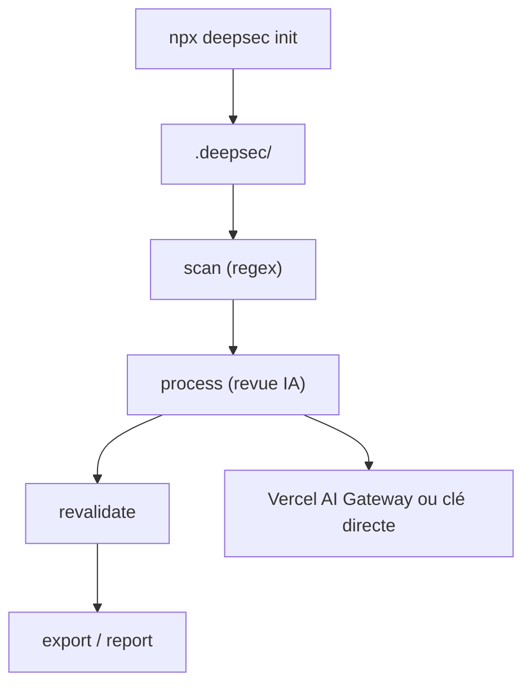

# vercel-labs/deepsec

> AI-agent-driven vulnerability scanner, for auditing large existing code repositories.

## The problem
Security flaws lie dormant for a long time in large codebases that classic reviews do not cover.

## What it actually does
A fast, free regex `scan` finds candidates, then `process` has them examined by an AI model. `revalidate` reduces false positives, `export` produces reports. An interrupted run resumes where it stopped. Large monorepos can be spread across Vercel Sandbox microVMs.

## How it is wired

Simplified diagram based on the README; no diagram provided.

## Trying it
```bash
npx deepsec init
npx deepsec init --max-cost-usd 100 --max-duration 2h
cd .deepsec
pnpm deepsec scan
pnpm deepsec process
pnpm deepsec export --format md-dir --out ./findings
```

## Cost and gotchas
The README states that scans can cost thousands, even tens of thousands of dollars on large codebases. Payment through an OpenAI/Anthropic key or Vercel AI Gateway. Use `--max-cost-usd` and `--max-duration`.

## What it is not
Not a free scanner: only the `scan` phase is. Treat it as an agent with full shell access to the machine; the README recommends the sandbox against prompt injection.

## Alternatives
No alternative named in the README.

## For you
Worth watching: interesting for auditing AI or MLOps code, but the cost, unbounded by default, requires setting a cap before trying it.
