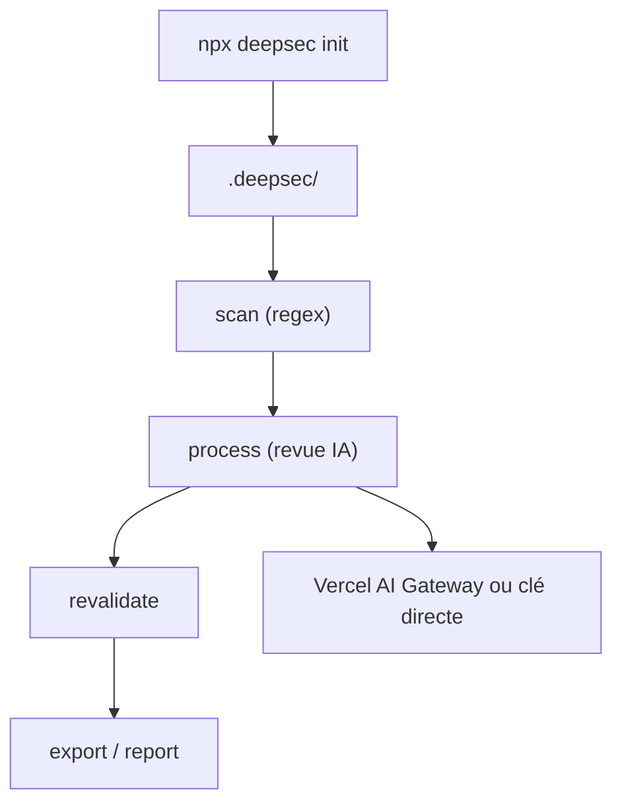

# vercel-labs/deepsec

> Scanner de vulnérabilités piloté par agents IA, pour auditer de gros dépôts de code existants.

## Le problème
Des failles de sécurité dorment depuis longtemps dans de grandes bases de code que les revues classiques ne couvrent pas.

## Ce que ça fait vraiment
Un `scan` rapide par regex et gratuit trouve des candidats, puis `process` les fait examiner par un modèle d'IA. `revalidate` réduit les faux positifs, `export` produit des rapports. Une exécution interrompue reprend où elle s'était arrêtée. Les gros monorepos peuvent être répartis sur des microVM Vercel Sandbox.

## Comment c'est branché

Schéma simplifié d'après le README ; aucun diagramme fourni.

## Essayer
```bash
npx deepsec init
npx deepsec init --max-cost-usd 100 --max-duration 2h
cd .deepsec
pnpm deepsec scan
pnpm deepsec process
pnpm deepsec export --format md-dir --out ./findings
```

## Coût et pièges
Le README annonce des scans pouvant coûter des milliers, voire des dizaines de milliers de dollars sur de grosses bases. Paiement par clé OpenAI/Anthropic ou Vercel AI Gateway. Utiliser `--max-cost-usd` et `--max-duration`.

## Ce que ce n'est pas
Pas un scanner gratuit : seule la phase `scan` l'est. À traiter comme un agent avec accès shell complet à la machine ; le README conseille le sandbox contre l'injection de prompt.

## Alternatives
Aucune alternative nommée dans le README.

## Pour toi
À surveiller : intéressant pour auditer du code d'IA ou de MLOps, mais le coût non borné par défaut impose de plafonner avant d'essayer.

