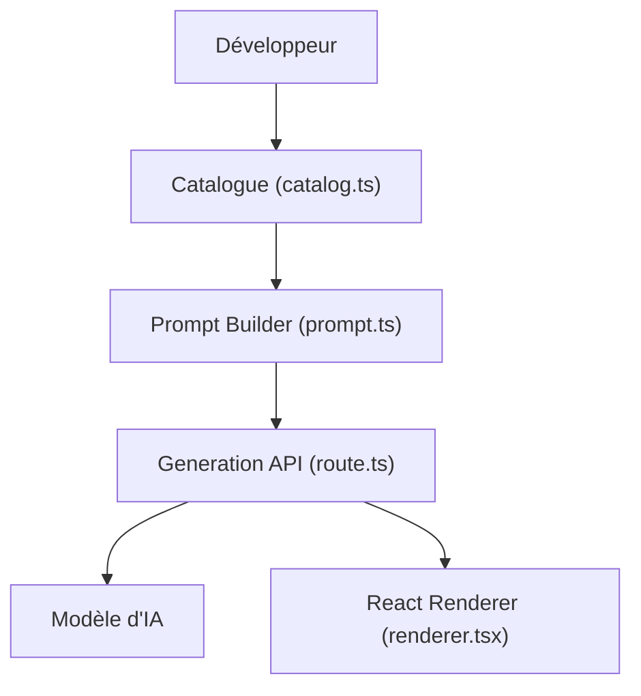

# vercel-labs/json-render

> Generative UI framework: a model produces JSON limited to your component catalog, rendered safely.

## The problem
Letting an LLM generate an interface without it inventing components or breaking the layout.

## What it actually does
You define a catalog (components with zod schemas, actions). The model generates a JSON spec constrained to that catalog, streamed, then a rendering engine displays it. Packages cover React, Vue, Svelte, Solid, React Native, PDF, email, Remotion video, 3D, terminal, Next.js and MCP.

## How it is wired
Diagram based on the one provided, reduced.



## Trying it
```bash
npm install @json-render/core @json-render/react
git clone https://github.com/vercel-labs/json-render
cd json-render
pnpm install
pnpm dev
```

## Cost and gotchas
Free (Apache-2.0), but generation calls an AI model: API key and bill are on you. Repository created in January 2026, versions still moving (an experimental composition requires pinning versions).

## What it is not
Not a model nor a standalone interface generator: it bounds the output of an LLM that you supply. No guarantee on the quality of what the model decides to display.

## Alternatives
No alternative named in the README.

## For you
Worth watching: useful for LLM applications with safe structured output (generated dashboards), worth testing if you build AI-driven interfaces.
