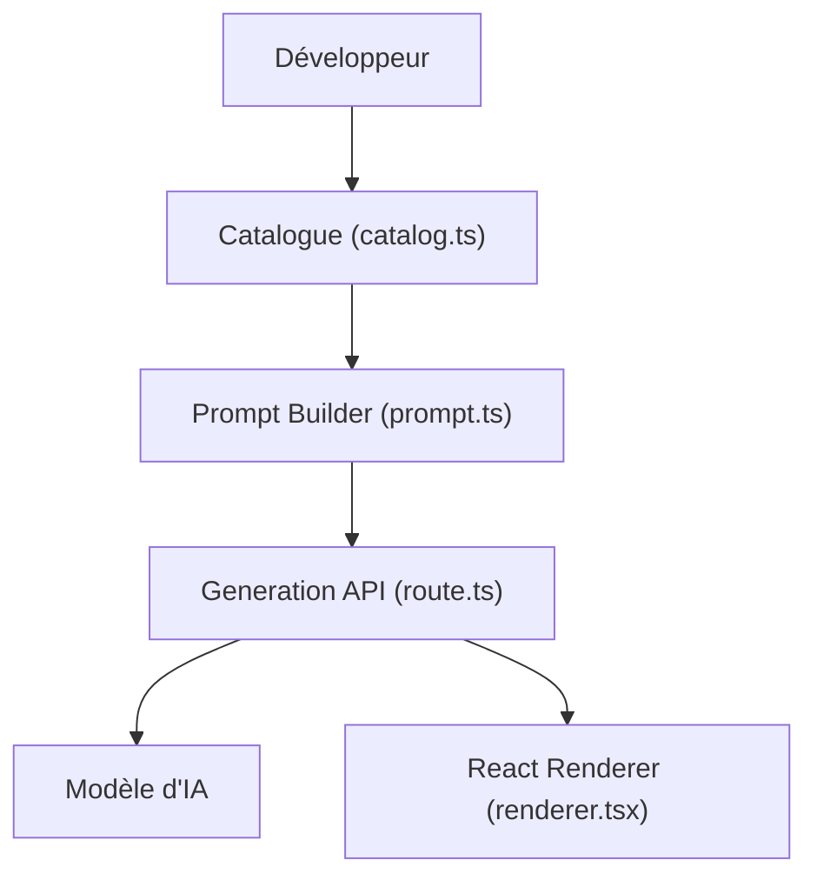

# vercel-labs/json-render

> Framework d'interfaces génératives : un modèle produit du JSON limité à ton catalogue de composants, rendu en sécurité.

## Le problème
Laisser un LLM générer une interface sans qu'il invente des composants ou casse la mise en page.

## Ce que ça fait vraiment
Tu définis un catalogue (composants avec schémas zod, actions). Le modèle génère une spec JSON contrainte à ce catalogue, diffusée en flux, puis un moteur de rendu l'affiche. Des paquets couvrent React, Vue, Svelte, Solid, React Native, PDF, e-mail, vidéo Remotion, 3D, terminal, Next.js et MCP.

## Comment c'est branché
Schéma d'après le diagramme fourni, réduit.



## Essayer
```bash
npm install @json-render/core @json-render/react
git clone https://github.com/vercel-labs/json-render
cd json-render
pnpm install
pnpm dev
```

## Coût et pièges
Gratuit (Apache-2.0), mais la génération appelle un modèle d'IA : clé d'API et facture à ta charge. Dépôt né en janvier 2026, versions encore mouvantes (une composition expérimentale demande de figer les versions).

## Ce que ce n'est pas
Pas un modèle ni un générateur d'interface autonome : il borne la sortie d'un LLM que tu fournis. Pas de garantie sur la qualité de ce que le modèle décide d'afficher.

## Alternatives
Aucune alternative nommée dans le README.

## Pour toi
À surveiller : utile pour des applications LLM avec sortie structurée et sûre (tableaux de bord générés), à tester si tu construis des interfaces pilotées par IA.

