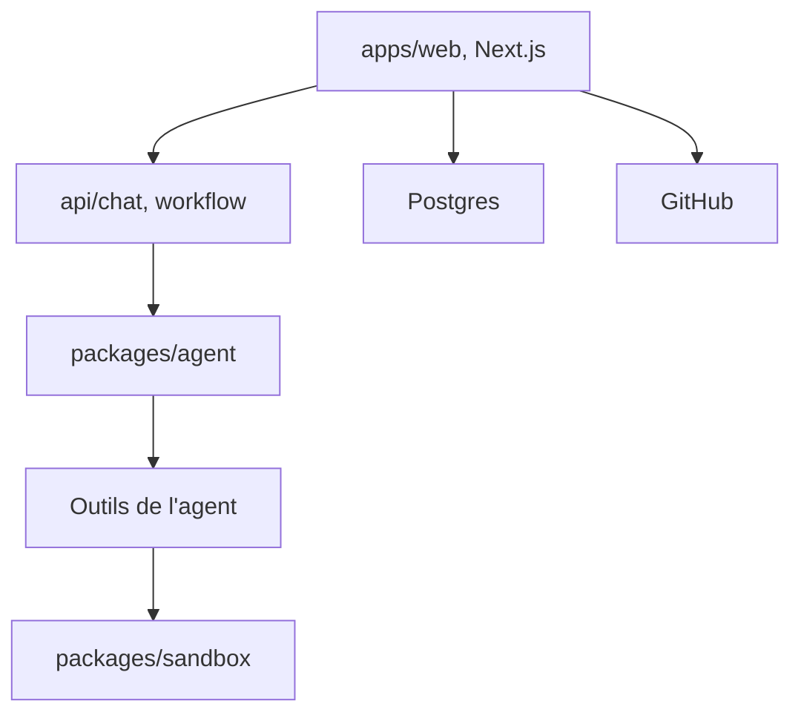

# vercel-labs/open-agents

> Reference application to run background coding agents on Vercel, from prompt to pull request.

## The problem
A coding agent that depends on your laptop stops when it does, and mixes reasoning and execution on the same machine.

## What it actually does
Three layers: a Next.js web app (auth, sessions, chat), the agent running as a durable workflow outside the sandbox, and a Vercel sandbox (files, shell, git, dev servers). The agent acts through tools, can clone, commit, push and open a PR, with read-only session sharing. Optional voice via ElevenLabs.

## How it is wired


## Trying it
```bash
corepack enable
pnpm install
cp apps/web/.env.example apps/web/.env
pnpm web
```

## Cost and gotchas
Vercel account, Postgres database, Vercel OAuth application, GitHub application, and many environment variables (BETTER_AUTH_SECRET, GitHub keys). The sandbox and workflows are billed by Vercel. "Hobby" profile planned.

## What it is not
Not a finished product: the README presents it as a base to fork. It depends on Vercel for the sandbox, workflows and authentication. Last push in August 2026.

## Alternatives
No alternative named in the README.

## For you
Keep an eye on it: useful to study an agent architecture outside the sandbox, but tied to Vercel and a heavy setup.
