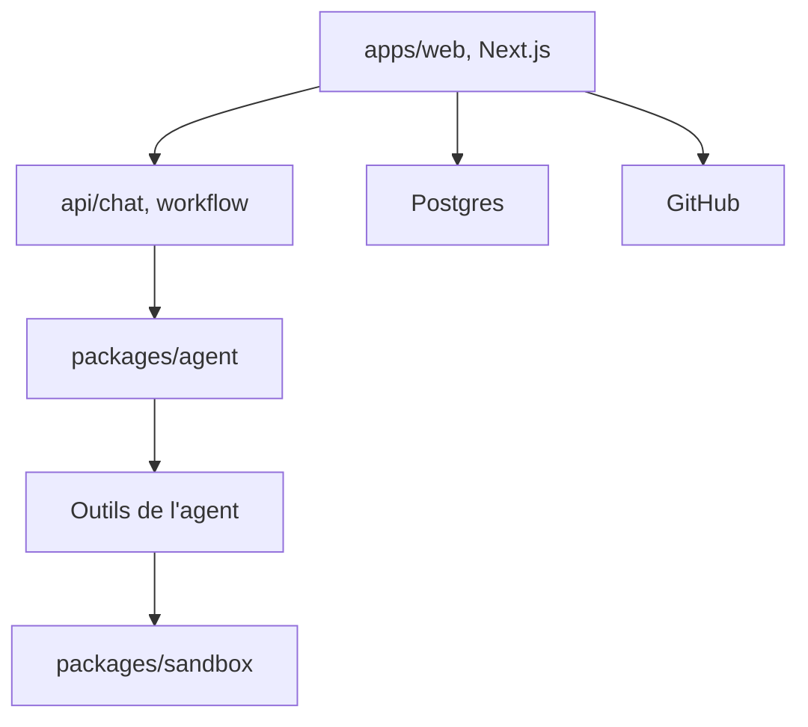

# vercel-labs/open-agents

> Application de référence pour lancer des agents de code en arrière-plan sur Vercel, du prompt à la pull request.

## Le problème
Un agent de code qui dépend de ton portable s'arrête avec lui, et mélange raisonnement et exécution dans la même machine.

## Ce que ça fait vraiment
Trois couches : appli web Next.js (auth, sessions, chat), agent exécuté comme workflow durable hors du bac à sable, et sandbox Vercel (fichiers, shell, git, serveurs de dev). L'agent agit par outils, peut cloner, committer, pousser et ouvrir une PR, avec partage de session en lecture seule. Voix optionnelle via ElevenLabs.

## Comment c'est branché


## Essayer
```bash
corepack enable
pnpm install
cp apps/web/.env.example apps/web/.env
pnpm web
```

## Coût et pièges
Compte Vercel, base Postgres, application OAuth Vercel, application GitHub, et variables d'environnement nombreuses (BETTER_AUTH_SECRET, clés GitHub). Le sandbox et les workflows sont facturés par Vercel. Profil « hobby » prévu.

## Ce que ce n'est pas
Pas un produit fini : le README le présente comme une base à forker. Il dépend de Vercel pour le sandbox, les workflows et l'authentification. Dernier push en août 2026.

## Alternatives
Aucune alternative nommée dans le README.

## Pour toi
À surveiller : utile pour étudier l'architecture agent hors sandbox, mais lié à Vercel et à une configuration lourde.

