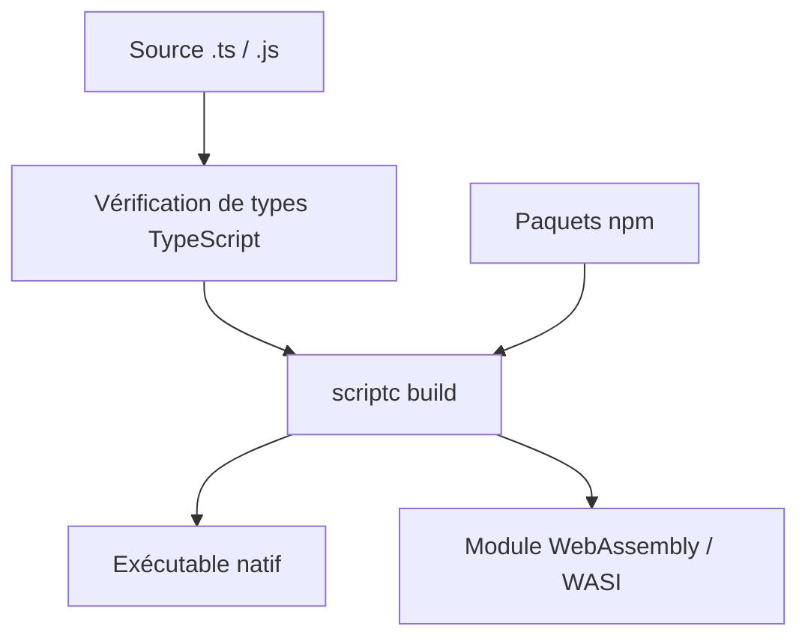

# vercel-labs/scriptc

> Compiler that turns TypeScript and JavaScript into native executables or WebAssembly, without Node.js at runtime.

## The problem
Shipping a TypeScript tool means bundling Node.js and its dependencies, which makes distribution heavier.

## What it actually does
Uses the types checked by the TypeScript compiler to produce machine code. Imported npm packages are compiled together with the program. Anything that does not compile is reported with a diagnostic and sometimes a rewrite suggestion. It only handles a subset of JavaScript, TypeScript and Node APIs.

## How it is wired
Simplified diagram based on the sheet, no diagram provided.


## Trying it
```bash
npm install -g scriptc
scriptc run hello.ts
scriptc build hello.ts -o hello
scriptc coverage hello.ts
```

## Cost and gotchas
Free. Node.js 24 or later to install it; building an executable requires a linker and the platform SDK. Support for npm packages is partial.

## What it is not
It is not a complete replacement for Node.js: the project calls itself experimental and covers only a subset.

## Alternatives
No alternative named in the README.

## For you
Watch: interesting for distributing a small tool as a single binary, but too young for a production pipeline.
