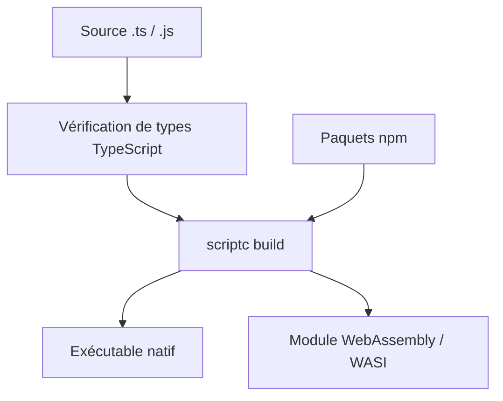

# vercel-labs/scriptc

> Compilateur qui transforme TypeScript et JavaScript en exécutables natifs ou WebAssembly, sans Node.js à l'exécution.

## Le problème
Livrer un outil TypeScript oblige à embarquer Node.js et ses dépendances, ce qui alourdit la distribution.

## Ce que ça fait vraiment
Utilise les types vérifiés par le compilateur TypeScript pour produire du code machine. Les paquets npm importés sont compilés avec le programme. Ce qui ne compile pas est signalé avec un diagnostic et parfois une suggestion de réécriture. Il ne gère qu'un sous-ensemble de JavaScript, TypeScript et des API Node.

## Comment c'est branché
Schéma simplifié d'après la fiche, sans diagramme fourni.


## Essayer
```bash
npm install -g scriptc
scriptc run hello.ts
scriptc build hello.ts -o hello
scriptc coverage hello.ts
```

## Coût et pièges
Gratuit. Node.js 24 ou plus pour l'installer ; construire un exécutable demande un éditeur de liens et le SDK de la plateforme. Le support des paquets npm est partiel.

## Ce que ce n'est pas
Ce n'est pas un remplaçant complet de Node.js : le projet se dit expérimental et ne couvre qu'un sous-ensemble.

## Alternatives
Aucune alternative nommée dans le README.

## Pour toi
À surveiller : intéressant pour distribuer un petit outil en binaire unique, mais trop jeune pour un pipeline de production.

