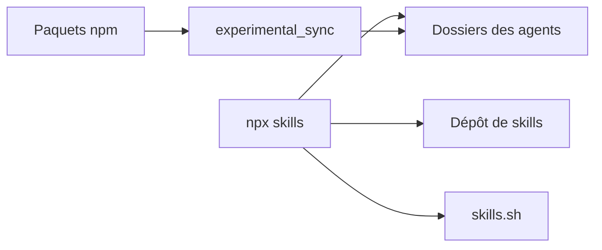

# vercel-labs/skills

> CLI to install, search and update coding-agent skills across more than 75 agents.

## The problem
Each coding agent stores its skills somewhere different. Installing, updating and sharing the same instructions across agents is done by hand.

## What it actually does
`npx skills add` copies skills into the project (or globally with `-g`) for the chosen agents. Other commands: `find`, `list`, `check`, `update`, `remove`, `init` (a `SKILL.md` template), `use` (generates a prompt or launches an agent with a skill). `experimental_sync` links skills provided by npm packages.

## How it is wired


## Trying it
```bash
npx skills add vercel-labs/agent-skills
npx skills add vercel-labs/agent-skills --skill web-design-guidelines -a claude-code
npx skills find
npx skills check
npx skills update
npx skills init my-skill
```

## Cost and gotchas
Free, Node 22.20 or later required. The CLI sends anonymous usage data; `DISABLE_TELEMETRY=1` or `DO_NOT_TRACK=1` turns it off, along with the security audit requests.

## What it is not
Not a skill catalogue: it is the installer; the content comes from other repos. The npm sync is marked experimental.

## Alternatives
Native agent plugins (Claude Code and Codex marketplaces): automatic updates without going through this CLI, each limited to its own agent.

## For you
Adopt: if you use more than one coding agent, this is the reference installer for the format; put the telemetry variable in your profile.
