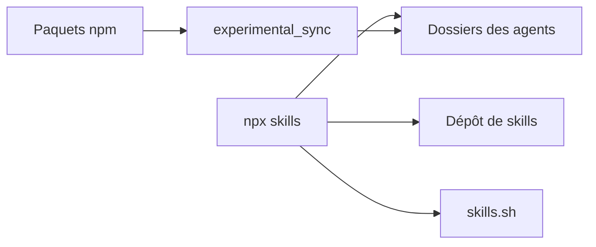

# vercel-labs/skills

> CLI pour installer, chercher et mettre à jour des skills d'agents de code sur plus de 75 agents.

## Le problème
Chaque agent de code range ses skills ailleurs. Installer, mettre à jour et partager les mêmes instructions entre agents se fait à la main.

## Ce que ça fait vraiment
`npx skills add` copie des skills dans le projet (ou globalement avec `-g`) pour les agents choisis. D'autres commandes : `find`, `list`, `check`, `update`, `remove`, `init` (gabarit de `SKILL.md`), `use` (génère un prompt ou lance un agent avec un skill). `experimental_sync` relie les skills fournis par des paquets npm.

## Comment c'est branché


## Essayer
```bash
npx skills add vercel-labs/agent-skills
npx skills add vercel-labs/agent-skills --skill web-design-guidelines -a claude-code
npx skills find
npx skills check
npx skills update
npx skills init my-skill
```

## Coût et pièges
Gratuit, Node 22.20 ou plus requis. Le CLI envoie des données d'usage anonymes ; `DISABLE_TELEMETRY=1` ou `DO_NOT_TRACK=1` les coupe, ainsi que les requêtes d'audit de sécurité.

## Ce que ce n'est pas
Pas un catalogue de skills : c'est l'installeur ; le contenu vient d'autres dépôts. La synchronisation npm est marquée expérimentale.

## Alternatives
Plugins natifs des agents (marketplaces de Claude Code, Codex) : mises à jour automatiques sans passer par ce CLI, chacun limité à son agent.

## Pour toi
À adopter : si tu utilises plus d'un agent de code, c'est l'installeur de référence du format ; mets la variable de télémétrie dans ton profil.

