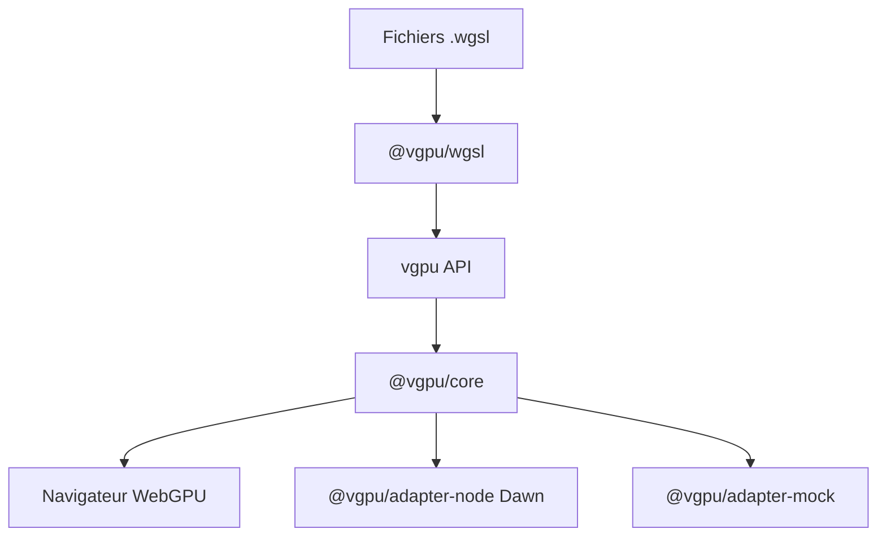

# vercel-labs/vgpu

> TypeScript library for WebGPU with typed WGSL imports, the same code in browser, Node and tests.

## The problem
Writing WebGPU requires a lot of hand-written binding declarations, and testing without a GPU is hard.

## What it actually does
`.wgsl` files are imported like TypeScript modules, and reflection keeps the names and types of the bindings. A single `Gpu` context is passed to every call (`draw`, `effect`, `frame`, `target`). Three environments: browser, headless Node via Dawn, and a deterministic mock adapter for tests. A CLI for docs, examples and shader checking, plus an MCP server.

## How it is wired
Simplified diagram based on the sheet, no diagram provided.



## Trying it
```bash
pnpm add vgpu
pnpm add -D @webgpu/types
npx vgpu docs cat getting-started.md
npx vgpu examples search "raymarching"
npx vgpu check
npx vgpu mcp
```

## Cost and gotchas
Free, MIT. A WebGPU-compatible GPU is required outside mock mode. Repository created in May 2026: the API is likely to keep changing.

## What it is not
Not a scene-graph 3D engine: passes are explicit. Not an AI compute tool, despite the `compute` function.

## Alternatives
No alternative named in the README.

## For you
Worth watching: GPU compute in TypeScript, testable without a graphics card, can be useful for demos, but the project is young and outside your core field.
