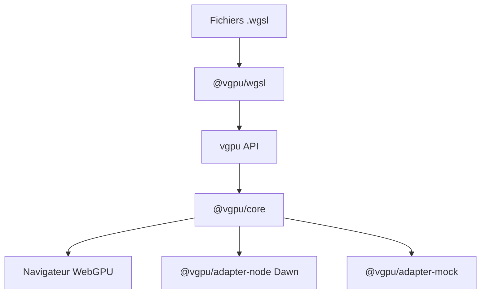

# vercel-labs/vgpu

> Bibliothèque TypeScript pour WebGPU avec imports WGSL typés, même code navigateur, Node et tests.

## Le problème
Écrire du WebGPU demande beaucoup de déclarations de bindings à la main, et tester sans GPU est difficile.

## Ce que ça fait vraiment
Les fichiers `.wgsl` s'importent comme des modules TypeScript, la réflexion garde les noms et types des bindings. Un seul contexte `Gpu` est passé à chaque appel (`draw`, `effect`, `frame`, `target`). Trois environnements : navigateur, Node sans écran via Dawn, et un adaptateur factice déterministe pour les tests. CLI de docs, exemples et vérification de shaders, plus un serveur MCP.

## Comment c'est branché
Schéma simplifié d'après la fiche, sans diagramme fourni.



## Essayer
```bash
pnpm add vgpu
pnpm add -D @webgpu/types
npx vgpu docs cat getting-started.md
npx vgpu examples search "raymarching"
npx vgpu check
npx vgpu mcp
```

## Coût et pièges
Gratuit, MIT. Un GPU compatible WebGPU est nécessaire hors mode factice. Dépôt créé en mai 2026 : API probablement mouvante.

## Ce que ce n'est pas
Pas un moteur 3D à graphe de scène : les passes sont explicites. Pas un outil de calcul d'IA, malgré la fonction `compute`.

## Alternatives
Aucune alternative nommée dans le README.

## Pour toi
À surveiller : le calcul GPU en TypeScript testable sans carte graphique peut servir à des démonstrations, mais le projet est jeune et hors cœur de métier.

