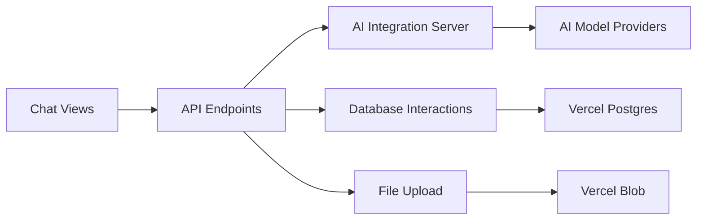

# vercel/ai-chatbot-svelte

> AI chatbot template in SvelteKit using Vercel's AI SDK, meant to be deployed on Vercel.

## The problem
Getting a full AI chatbot started (history, authentication, files) without assembling everything yourself.

## What it actually does
A SvelteKit 5 application with shadcn-svelte and Tailwind. The AI SDK calls a provider, xAI `grok-2-1212` by default, which can be swapped. Vercel Postgres (Neon) stores the history and Vercel Blob stores the files. API routes handle chat, files and authentication.

## How it is wired


## Trying it
```bash
npm i -g vercel
vercel link
vercel env pull
pnpm install
pnpm db:generate
pnpm dev
```

## Cost and gotchas
The model provider key is at your expense, plus Vercel, Neon and Blob accounts. Never commit the `.env` file. Last push in June 2025: the default model is probably outdated.

## What it is not
Not a ready-to-use chat platform: a starter template tied to the Vercel ecosystem. License not identified by GitHub.

## Alternatives
No alternative named in the README.

## For you
Worth watching: a good starting point for a chat prototype, but old and heavily tied to Vercel.
