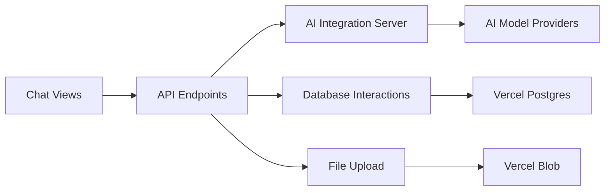

# vercel/ai-chatbot-svelte

> Modèle de chatbot IA en SvelteKit avec le SDK IA de Vercel, à déployer sur Vercel.

## Le problème
Démarrer un chatbot IA complet (historique, authentification, fichiers) sans tout assembler soi-même.

## Ce que ça fait vraiment
Application SvelteKit 5 avec shadcn-svelte et Tailwind. Le SDK IA appelle un fournisseur, xAI `grok-2-1212` par défaut, interchangeable. Vercel Postgres (Neon) garde l'historique et Vercel Blob les fichiers. Des routes d'API gèrent chat, fichiers et authentification.

## Comment c'est branché


## Essayer
```bash
npm i -g vercel
vercel link
vercel env pull
pnpm install
pnpm db:generate
pnpm dev
```

## Coût et pièges
Clé du fournisseur de modèle à ta charge, plus comptes Vercel, Neon et Blob. Ne jamais commiter le fichier `.env`. Dernier push en juin 2025 : modèle par défaut probablement dépassé.

## Ce que ce n'est pas
Pas une plateforme de chat prête à l'emploi : un modèle de départ lié à l'écosystème Vercel. Licence non identifiée par GitHub.

## Alternatives
Aucune alternative nommée dans le README.

## Pour toi
À surveiller : bon point de départ pour un prototype de chat, mais ancien et très lié à Vercel.

