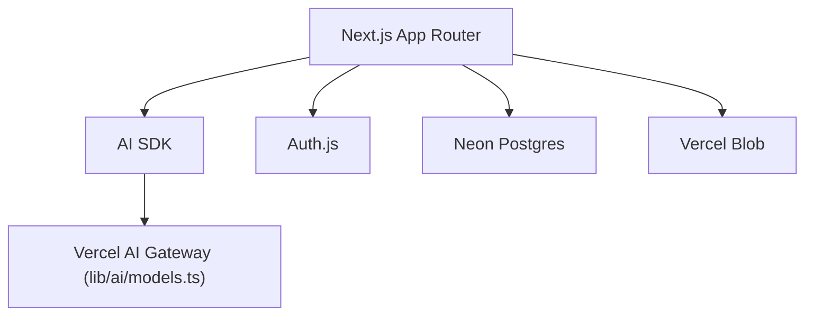

# vercel/ai-chatbot

> Next.js chatbot template with the AI SDK, for developers wanting a ready-made chat interface.

## The problem
Building a chat interface with history, authentication and streaming takes time.

## What it actually does
Next.js template (App Router, Server Components) that calls models through Vercel AI Gateway (Mistral, Moonshot, DeepSeek, OpenAI, xAI) with the AI SDK. History in Neon Postgres, files in Vercel Blob, Auth.js authentication, shadcn/ui interface.

## How it is wired
Architecture not documented in the material provided (no diagram).


## Trying it
```bash
npm i -g vercel
vercel link
vercel env pull
pnpm install
pnpm db:migrate
pnpm dev
```

## Cost and gotchas
Outside Vercel, `AI_GATEWAY_API_KEY` is required. Neon and Blob are third-party services, potentially paid. Never commit `.env`.

## What it is not
Not an agent framework nor a finished product: a starting point coupled to the Vercel ecosystem.

## Alternatives
No alternative named in the README.

## For you
Watch: good template for a chat demo around a model, but Vercel coupling and unidentified license.
