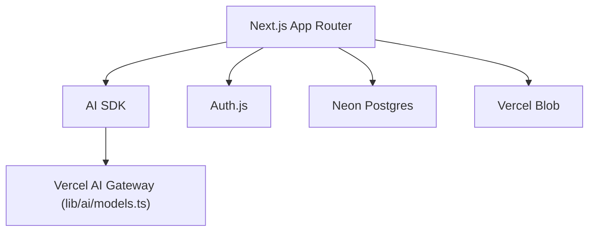

# vercel/ai-chatbot

> Gabarit de chatbot Next.js avec le AI SDK, pour développeurs voulant une interface de chat prête.

## Le problème
Monter une interface de chat avec historique, authentification et streaming prend du temps.

## Ce que ça fait vraiment
Gabarit Next.js (App Router, Server Components) qui appelle des modèles via Vercel AI Gateway (Mistral, Moonshot, DeepSeek, OpenAI, xAI) avec le AI SDK. Historique dans Neon Postgres, fichiers dans Vercel Blob, authentification Auth.js, interface shadcn/ui.

## Comment c'est branché
Architecture non documentée dans le matériau fourni (pas de diagramme).


## Essayer
```bash
npm i -g vercel
vercel link
vercel env pull
pnpm install
pnpm db:migrate
pnpm dev
```

## Coût et pièges
Hors Vercel, il faut `AI_GATEWAY_API_KEY`. Neon et Blob sont des services tiers, potentiellement payants. Ne jamais commiter `.env`.

## Ce que ce n'est pas
Pas un framework d'agents ni un produit fini : un point de départ couplé à l'écosystème Vercel.

## Alternatives
Aucune alternative nommée dans le README.

## Pour toi
Surveiller : bon gabarit pour une démo de chat autour d'un modèle, mais couplage Vercel et licence non identifiée.

