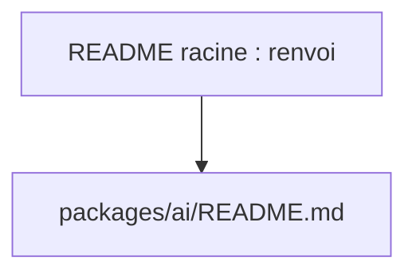

# vercel/ai

> Insufficient material: the provided README is reduced to a file path, so the repo cannot be described.

## The problem
Not documented in the material provided.

## What it actually does
Not documented: the README only contains `packages/ai/README.md`. No diagram or architecture is provided. Nothing is inferred here.

## How it is wired

Only link visible in the material.

## Trying it
No command documented in the material provided. Read `packages/ai/README.md` in the repo.

## Cost and gotchas
Not documented. A license is present but not identified by GitHub: check it before use.

## What it is not
This sheet is not a description of the product: it only flags that the material is missing. To be rerun with the sub-package's README.

## Alternatives
None named in the README provided.

## For you
Keep an eye on it by default (very active repo, 27,792 stars, push today) pending a read of the real README, since the verdict is not substantiated.
