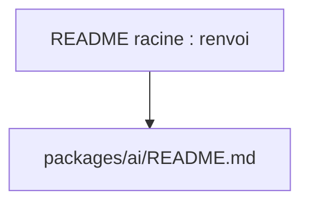

# vercel/ai

> Matière insuffisante : le README fourni se réduit à un chemin de fichier, impossible de décrire le dépôt.

## Le problème
Non documenté dans la matière fournie.

## Ce que ça fait vraiment
Non documenté : le README ne contient que `packages/ai/README.md`. Aucun diagramme ni architecture n'est fourni. Rien n'est déduit ici.

## Comment c'est branché

Seul lien visible dans la matière.

## Essayer
Aucune commande documentée dans la matière fournie. Lire `packages/ai/README.md` dans le dépôt.

## Coût et pièges
Non documenté. La licence est présente mais non identifiée par GitHub : à vérifier avant usage.

## Ce que ce n'est pas
Cette fiche n'est pas une description du produit : elle signale seulement que la matière manque. À relancer avec le README du sous-paquet.

## Alternatives
Aucune nommée dans le README fourni.

## Pour toi
À surveiller par défaut (dépôt très actif, 27 792 étoiles, push du jour) en attendant une lecture du vrai README, le verdict n'étant pas étayé.

