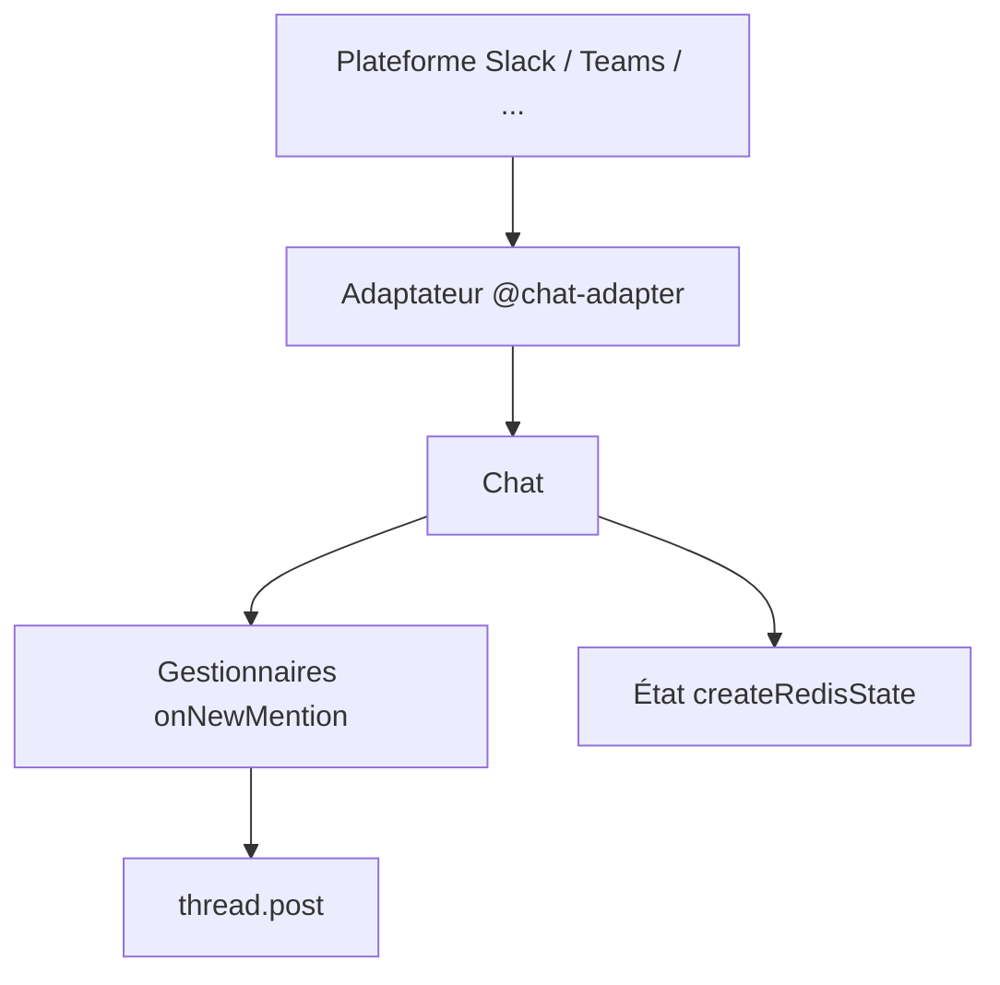

# vercel/chat

> TypeScript SDK to write a bot once and deploy it on Slack, Teams, Discord, Telegram and others.

## The problem
Each messaging platform has its own API, cards and events. Writing a bot for several platforms is repetitive.

## What it actually does
A `Chat` class with per-platform adapters and a state store (Redis, for example). Handles mentions, messages, reactions, buttons, slash commands, modals, JSX cards, files and ephemeral messages. Streams an LLM's replies. A catalog of adapters and a `create-chat-sdk` tool generate a Next.js application.

## How it is wired
Simplified diagram based on the sheet, no diagram provided.



## Trying it
```bash
npm i chat
npm install @chat-adapter/slack @chat-adapter/teams @chat-adapter/gchat
npx create-chat-sdk@latest my-bot
```

## Cost and gotchas
Free, MIT. Each platform requires its own account and API secrets. The README does not detail the cost of the connected LLMs.

## What it is not
Not an LLM nor an agent: it handles transport and the chat interface. No business logic provided.

## Alternatives
No alternative named in the README.

## For you
Watch: handy for exposing an AI assistant on Slack or Teams, with response streaming, if you are comfortable in TypeScript.
