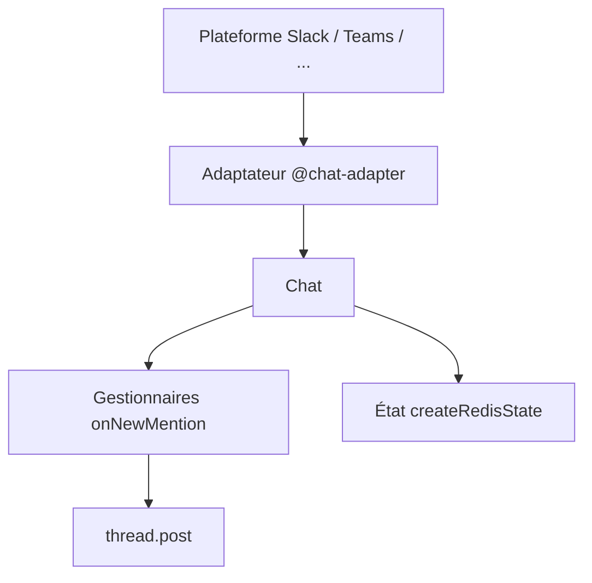

# vercel/chat

> SDK TypeScript pour écrire un bot une fois et le déployer sur Slack, Teams, Discord, Telegram et autres.

## Le problème
Chaque plateforme de messagerie a son API, ses cartes et ses événements. Écrire un bot pour plusieurs plateformes se répète.

## Ce que ça fait vraiment
Une classe `Chat` avec des adaptateurs par plateforme et un état (Redis, par exemple). Gère mentions, messages, réactions, boutons, commandes slash, modales, cartes JSX, fichiers et messages éphémères. Diffuse en continu les réponses d'un LLM. Un catalogue d'adaptateurs et un outil `create-chat-sdk` génèrent une application Next.js.

## Comment c'est branché
Schéma simplifié d'après la fiche, sans diagramme fourni.



## Essayer
```bash
npm i chat
npm install @chat-adapter/slack @chat-adapter/teams @chat-adapter/gchat
npx create-chat-sdk@latest my-bot
```

## Coût et pièges
Gratuit, MIT. Chaque plateforme demande son propre compte et ses secrets d'API. Le README ne détaille pas le coût des LLM branchés.

## Ce que ce n'est pas
Pas un LLM ni un agent : il gère le transport et l'interface de chat. Pas de logique métier fournie.

## Alternatives
Aucune alternative nommée dans le README.

## Pour toi
À surveiller : pratique pour exposer un assistant IA sur Slack ou Teams, avec streaming de réponses, si tu es à l'aise en TypeScript.

