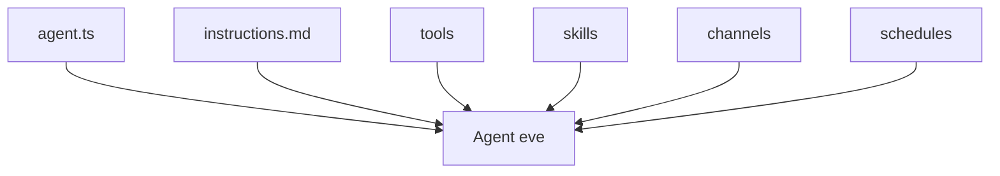

# vercel/eve

> TypeScript framework where a durable AI agent is described by conventional files and folders.

## The problem
AI agents are often a heap of code that is hard to inspect, extend and operate.

## What it actually does
An agent is an `agent/` folder: `instructions.md` (system prompt), `tools/` (functions typed with zod), `skills/`, `channels/` (HTTP, Slack, Discord), `schedules/` (cron), `agent.ts` for model and reasoning. Models via AI Gateway. Adds a web chat with Vercel login. Full documentation is in `node_modules/eve/docs`.

## How it is wired
Simplified diagram based on the sheet, no diagram provided.



## Trying it
```bash
npx eve@latest init my-agent
npm run dev
npx eve link
npx eve add channel/web
npx eve deploy
```

## Cost and gotchas
Model called via AI Gateway: cost on you. The web chat and deployment go through a Vercel account. Young repo (created in June 2026), 914 open issues.

## What it is not
Not a model nor an evaluation platform: a structuring framework. Strongly tied to the Vercel ecosystem.

## Alternatives
No alternative named in the README.

## For you
Worth watching: the file-based approach is interesting for versioned agents, but young and coupled to Vercel.
