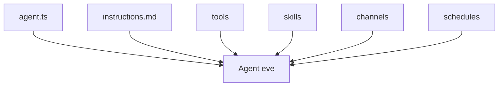

# vercel/eve

> Framework TypeScript où un agent IA durable se décrit par des fichiers et dossiers conventionnels.

## Le problème
Les agents IA sont souvent un amas de code difficile à inspecter, à étendre et à exploiter.

## Ce que ça fait vraiment
Un agent est un dossier `agent/` : `instructions.md` (prompt système), `tools/` (fonctions typées avec zod), `skills/`, `channels/` (HTTP, Slack, Discord), `schedules/` (cron), `agent.ts` pour modèle et raisonnement. Modèles via AI Gateway. Ajout d'un chat web avec connexion Vercel. La documentation complète est dans `node_modules/eve/docs`.

## Comment c'est branché
Schéma simplifié d'après la fiche, sans diagramme fourni.



## Essayer
```bash
npx eve@latest init my-agent
npm run dev
npx eve link
npx eve add channel/web
npx eve deploy
```

## Coût et pièges
Modèle appelé via AI Gateway : coût à ta charge. Le chat web et le déploiement passent par un compte Vercel. Dépôt jeune (créé en juin 2026), 914 issues ouvertes.

## Ce que ce n'est pas
Pas un modèle ni une plateforme d'évaluation : un cadre de structuration. Fortement lié à l'écosystème Vercel.

## Alternatives
Aucune alternative nommée dans le README.

## Pour toi
À surveiller : l'approche par fichiers est intéressante pour des agents versionnés, mais jeune et couplée à Vercel.

